# 优惠券设计

## 数据库表设计

**模型总览：**

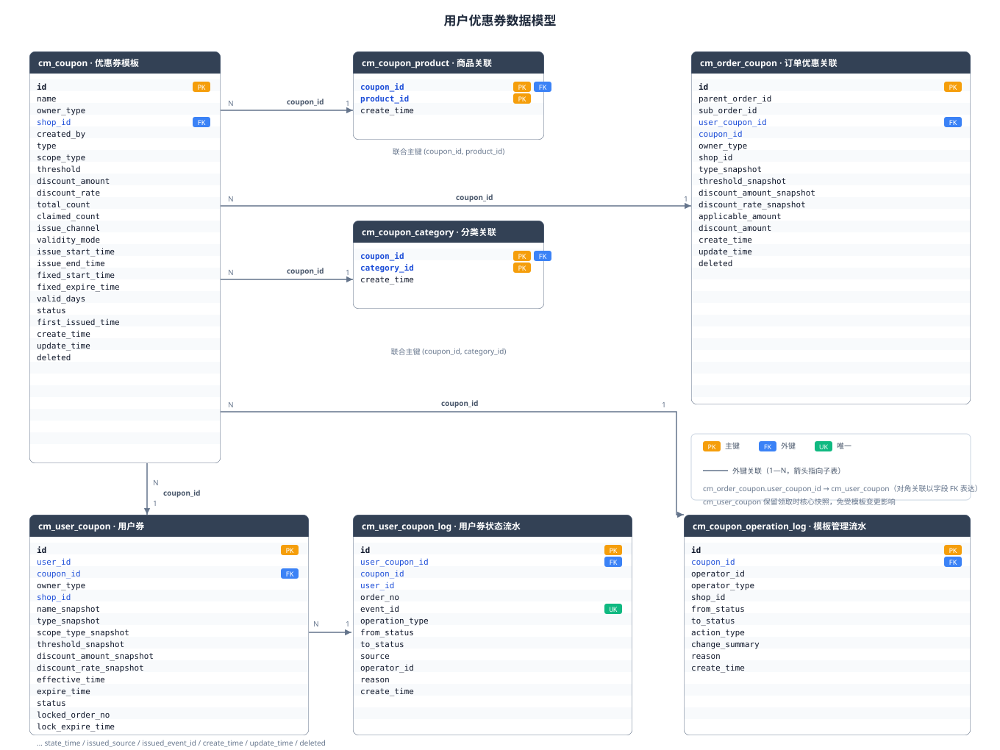

7 张表（含两张范围关联表），全部落在单库 `cm_mall`：

| 表 | 角色 |
|----|------|
| `cm_coupon` | 优惠券模板（主表，非用户资产） |
| `cm_coupon_product` | 券 ↔ 商品 SPU 范围关联（junction） |
| `cm_coupon_category` | 券 ↔ 分类范围关联（junction） |
| `cm_user_coupon` | 用户实际持有的券（含领取时核心快照） |
| `cm_user_coupon_log` | 用户券状态流水（追加写入） |
| `cm_coupon_operation_log` | 模板管理流水（追加写入） |
| `cm_order_coupon` | 订单优惠关联（记录本次订单实际用券快照） |

### 优惠券模板

`cm_coupon` 表语义为优惠券模板，不是用户持有的优惠券资产。

| 字段 | 类型 | 约束 | 说明 |
|------|------|------|------|
| `id` | bigint | PK, AUTO_INCREMENT | 优惠券模板 ID |
| `name` | varchar(100) | NOT NULL | 券展示名称 |
| `owner_type` | varchar(20) | NOT NULL | 券归属：`PLATFORM` / `SHOP` |
| `shop_id` | bigint | NULL | 店铺 ID（平台券为 NULL，店铺券必须有值） |
| `created_by` | bigint | NULL | 创建人 ID（仅用于审计） |
| `type` | varchar(20) | NOT NULL | 券类型：`FULL_REDUCTION` / `DISCOUNT` / `CASH` |
| `scope_type` | varchar(20) | NOT NULL | 适用范围：`ALL` / `PRODUCT` / `CATEGORY` |
| `threshold` | decimal(18,2) | NOT NULL, DEFAULT 0.00 | 使用门槛（0 表示无门槛） |
| `discount_amount` | decimal(18,2) | NULL | 满减/立减优惠金额 |
| `discount_rate` | decimal(8,6) | NULL | 折扣券减免比例（0.10 表示减免 10%） |
| `total_count` | bigint | NULL | 发行总量（NULL = 不限量，正数 = 发行上限） |
| `claimed_count` | bigint | NOT NULL, DEFAULT 0 | 累计成功发放数量（只增不减） |
| `issue_channel` | varchar(20) | NULL | 发放渠道：`PUBLIC_CLAIM` / `REGISTER_AUTO` / NULL（未设置不可发布） |
| `validity_mode` | varchar(20) | NOT NULL | 有效期模式：`FIXED` / `RELATIVE` |
| `issue_start_time` | datetime | NULL | 发放窗口开始时间 |
| `issue_end_time` | datetime | NULL | 发放窗口结束时间 |
| `fixed_start_time` | datetime | NULL | FIXED 模式用户券生效时间 |
| `fixed_expire_time` | datetime | NULL | FIXED 模式用户券过期时间 |
| `valid_days` | int | NULL | RELATIVE 模式发放后有效天数 |
| `status` | varchar(20) | NOT NULL, DEFAULT 'DRAFT' | 模板状态：`DRAFT` / `ACTIVE` / `PAUSED` / `ENDED` |
| `first_issued_time` | datetime | NULL | 首次发放时间 |
| `create_time` | datetime | NULL | 创建时间 |
| `update_time` | datetime | NULL | 更新时间 |
| `deleted` | tinyint(1) | NOT NULL, DEFAULT 0 | 软删除（仅未发放草稿可删除） |

**索引：**

| 索引名 | 类型 | 字段 |
|--------|------|------|
| PRIMARY | PK | `id` |
| idx_owner_shop | KEY | `owner_type, shop_id` |
| idx_status | KEY | `status` |
| idx_issue_window | KEY | `issue_start_time, issue_end_time` |

**模板约束：**

- `owner_type = PLATFORM` 时 `shop_id IS NULL`。
- `owner_type = SHOP` 时 `shop_id IS NOT NULL`，商家端通过当前用户解析唯一店铺。
- `type = FULL_REDUCTION`：`threshold > 0`、`discount_amount > 0`、`discount_amount < threshold`。
- `type = CASH`：`threshold >= 0`、`discount_amount > 0`。
- `type = DISCOUNT`：`threshold >= 0`、`0 < discount_rate < 1`。
- `issue_channel` 为单值发放渠道：`PUBLIC_CLAIM` 或 `REGISTER_AUTO`，一个模板只能设置一种，发布时必须已设置。
- 注册自动发放必须满足 `owner_type = PLATFORM` 且 `issue_channel = REGISTER_AUTO`。
- `scope_type = PRODUCT` 时必须存在商品关联；`scope_type = CATEGORY` 时必须存在分类关联；`ALL` 不产生范围关联记录。
- `issue_start_time < issue_end_time`。
- 固定有效期要求 `fixed_start_time < fixed_expire_time`。
- 相对有效期要求 `valid_days > 0`。
- 模板首次发布后核心规则冻结：类型、归属、门槛、优惠值、适用范围、发放方式和有效期均不可修改。
- 已发放模板不能删除，只能暂停或结束。

### 商品和优惠券关联

| 字段 | 类型 | 约束 | 说明 |
|------|------|------|------|
| `coupon_id` | bigint | NOT NULL | 优惠券模板 ID |
| `product_id` | bigint | NOT NULL | 商品 SPU ID |
| `create_time` | datetime | NULL | 创建时间 |

**索引：**

| 索引名 | 类型 | 字段 |
|--------|------|------|
| PRIMARY | PK | `(coupon_id, product_id)` |
| idx_product_id | KEY | `product_id` |

店铺券写入目标商品时，必须确认商品属于该店铺；平台券可关联平台内任意商品。商品范围覆盖该 SPU 全部 SKU。

### 分类和优惠券关联

| 字段 | 类型 | 约束 | 说明 |
|------|------|------|------|
| `coupon_id` | bigint | NOT NULL | 优惠券模板 ID |
| `category_id` | bigint | NOT NULL | 分类树根节点 ID |
| `create_time` | datetime | NULL | 创建时间 |

**索引：**

| 索引名 | 类型 | 字段 |
|--------|------|------|
| PRIMARY | PK | `(coupon_id, category_id)` |
| idx_category_id | KEY | `category_id` |

计算适用性时，商品命中目标分类或目标分类的任意后代分类即视为命中。店铺券还必须校验商品属于券归属店铺。

### 用户券

用户券表示用户实际持有的优惠权益。模板发布后规则冻结，用户券仍保存领取时核心快照，避免模板软删除或运营操作影响用户展示和历史追溯。

| 字段 | 类型 | 约束 | 说明 |
|------|------|------|------|
| `id` | bigint | PK, AUTO_INCREMENT | 用户券 ID |
| `user_id` | bigint | NOT NULL | 用户 ID |
| `coupon_id` | bigint | NOT NULL | 模板 ID |
| `owner_type` | varchar(20) | NOT NULL | 领取时归属快照：`PLATFORM` / `SHOP` |
| `shop_id` | bigint | NULL | 店铺券归属快照 |
| `name_snapshot` | varchar(100) | NOT NULL | 名称快照 |
| `type_snapshot` | varchar(20) | NOT NULL | 类型快照 |
| `scope_type_snapshot` | varchar(20) | NOT NULL | 范围类型快照 |
| `threshold_snapshot` | decimal(18,2) | NOT NULL, DEFAULT 0.00 | 门槛快照 |
| `discount_amount_snapshot` | decimal(18,2) | NULL | 金额优惠快照 |
| `discount_rate_snapshot` | decimal(8,6) | NULL | 比例优惠快照 |
| `effective_time` | datetime | NOT NULL | 本张用户券实际生效时间 |
| `expire_time` | datetime | NOT NULL | 本张用户券实际过期时间 |
| `status` | varchar(20) | NOT NULL, DEFAULT 'AVAILABLE' | 用户券状态：`AVAILABLE` / `LOCKED` / `USED` / `EXPIRED` / `REVOKED` |
| `locked_order_no` | varchar(64) | NULL | 当前锁定订单号（非永久历史） |
| `lock_expire_time` | datetime | NULL | 当前锁定过期时间 |
| `state_time` | datetime | NULL | 当前状态变更时间 |
| `issued_source` | varchar(30) | NOT NULL | 发放来源：`PUBLIC_CLAIM` / `REGISTER_AUTO` |
| `issued_event_id` | varchar(64) | NULL | 自动发放事件 ID（公开领取为空） |
| `create_time` | datetime | NULL | 发放时间 |
| `update_time` | datetime | NULL | 更新时间 |
| `deleted` | tinyint(1) | NOT NULL, DEFAULT 0 | 软删除 |

**索引：**

| 索引名 | 类型 | 字段 |
|--------|------|------|
| PRIMARY | PK | `id` |
| uk_user_coupon | UNIQUE | `(user_id, coupon_id)` |
| idx_user_status | KEY | `(user_id, status)` |
| idx_coupon_id | KEY | `coupon_id` |
| idx_locked_order | KEY | `locked_order_no` |

**约束：**

- 唯一索引 `(user_id, coupon_id)`，保证同一用户同一模板只有一张用户券。
- 不保存永久 `order_id`。用户券可能全额退款回退后再次使用，历史关联通过状态流水和订单优惠快照追溯。
- `LOCKED` 时只能绑定一个未结束订单。
- 用户券核心快照创建后不可修改。

### 用户券状态流水

流水为追加写入，不允许修改和删除。

| 字段 | 类型 | 约束 | 说明 |
|------|------|------|------|
| `id` | bigint | PK, AUTO_INCREMENT | 流水 ID |
| `user_coupon_id` | bigint | NOT NULL | 用户券 ID |
| `coupon_id` | bigint | NOT NULL | 模板 ID |
| `user_id` | bigint | NOT NULL | 用户 ID |
| `order_no` | varchar(64) | NULL | 相关订单号 |
| `event_id` | varchar(64) | NULL | 事件/操作幂等 ID |
| `operation_type` | varchar(30) | NOT NULL | 操作类型：`ISSUE` / `LOCK` / `COMMIT` / `RELEASE` / `REVERT` / `EXPIRE` / `REVOKE` |
| `from_status` | varchar(20) | NULL | 原状态 |
| `to_status` | varchar(20) | NULL | 新状态 |
| `source` | varchar(20) | NOT NULL | 来源：`USER` / `ORDER` / `PAYMENT` / `SYSTEM` / `OPERATOR` |
| `operator_id` | bigint | NULL | 操作人 ID（系统事件为空） |
| `reason` | varchar(500) | NULL | 原因 |
| `create_time` | datetime | NULL | 发生时间 |

**索引：**

| 索引名 | 类型 | 字段 |
|--------|------|------|
| PRIMARY | PK | `id` |
| uk_event_operation | UNIQUE | `(event_id, operation_type)` |
| idx_user_coupon_id | KEY | `user_coupon_id` |
| idx_coupon_id | KEY | `coupon_id` |
| idx_user_id | KEY | `user_id` |
| idx_order_no | KEY | `order_no` |

该表同时支撑状态审计、幂等判断和基础统计。

### 模板管理流水

记录模板创建、发布、暂停、恢复、结束、删除、库存调整和紧急撤销等管理操作。

| 字段 | 类型 | 约束 | 说明 |
|------|------|------|------|
| `id` | bigint | PK, AUTO_INCREMENT | 流水 ID |
| `coupon_id` | bigint | NOT NULL | 模板 ID |
| `operator_id` | bigint | NOT NULL | 操作人 ID |
| `operator_type` | varchar(20) | NOT NULL | 操作人类型：`OPERATOR` / `MERCHANT` |
| `shop_id` | bigint | NULL | 店铺 ID（平台券为 NULL） |
| `from_status` | varchar(20) | NULL | 操作前状态 |
| `to_status` | varchar(20) | NULL | 操作后状态 |
| `action_type` | varchar(30) | NOT NULL | 操作类型：`CREATE` / `UPDATE` / `PUBLISH` / `PAUSE` / `RESUME` / `END` / `DELETE` / `STOCK_ADJUST` / `REVOKE` |
| `change_summary` | varchar(500) | NULL | 变更摘要 |
| `reason` | varchar(500) | NULL | 原因 |
| `create_time` | datetime | NULL | 创建时间 |

**索引：**

| 索引名 | 类型 | 字段 |
|--------|------|------|
| PRIMARY | PK | `id` |
| idx_coupon_id | KEY | `coupon_id` |
| idx_operator_id | KEY | `operator_id` |
| idx_shop_id | KEY | `shop_id` |

运营端可查询全量，商家端只能查询自身店铺，流水追加写入。

### 订单优惠关联

记录本次订单实际使用的用户券，不重新读取当前模板计算历史金额。

| 字段 | 类型 | 约束 | 说明 |
|------|------|------|------|
| `id` | bigint | PK, AUTO_INCREMENT | 订单优惠关联 ID |
| `parent_order_id` | bigint | NOT NULL | 父订单 ID |
| `sub_order_id` | bigint | NULL | 子订单 ID（平台券为 NULL） |
| `user_coupon_id` | bigint | NOT NULL | 用户券 ID |
| `coupon_id` | bigint | NOT NULL | 模板 ID |
| `owner_type` | varchar(20) | NOT NULL | 券归属：`PLATFORM` / `SHOP` |
| `shop_id` | bigint | NULL | 店铺 ID |
| `type_snapshot` | varchar(20) | NOT NULL | 券类型快照 |
| `threshold_snapshot` | decimal(18,2) | NOT NULL, DEFAULT 0.00 | 门槛快照 |
| `discount_amount_snapshot` | decimal(18,2) | NULL | 金额优惠快照 |
| `discount_rate_snapshot` | decimal(8,6) | NULL | 比例优惠快照 |
| `applicable_amount` | decimal(18,2) | NOT NULL, DEFAULT 0.00 | 适用金额 |
| `discount_amount` | decimal(18,2) | NOT NULL, DEFAULT 0.00 | 实际优惠金额 |
| `create_time` | datetime | NULL | 创建时间 |
| `update_time` | datetime | NULL | 更新时间 |
| `deleted` | tinyint(1) | NOT NULL, DEFAULT 0 | 软删除 |

**索引：**

| 索引名 | 类型 | 字段 |
|--------|------|------|
| PRIMARY | PK | `id` |
| idx_parent_order_id | KEY | `parent_order_id` |
| idx_sub_order_id | KEY | `sub_order_id` |
| idx_user_coupon_id | KEY | `user_coupon_id` |

平台券关联父订单，店铺券关联对应店铺子订单。

---

## 状态流转

### 模板状态机

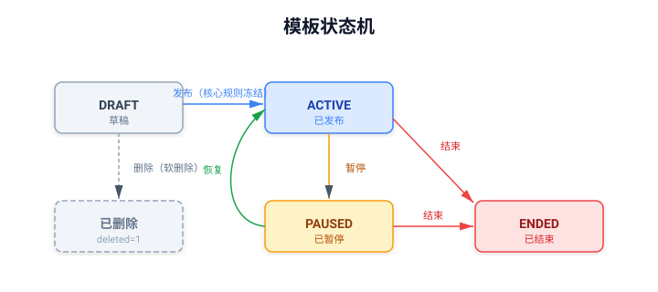

### 用户券状态机

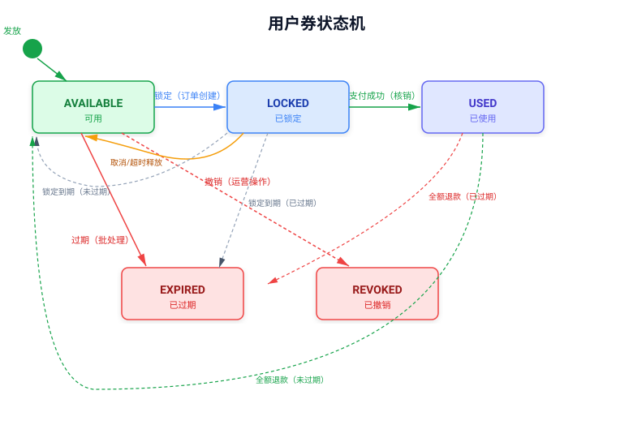

## 相关工作流

### 用户端

#### 浏览与领取优惠券

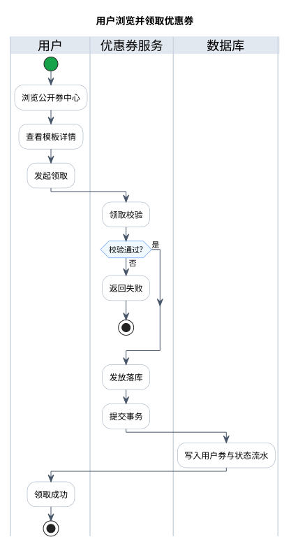

- 流程涉及接口（完整接口定义见「接口设计」用户端 API）：
  - 浏览公开券中心：`GET /coupons`
  - 查看模板详情：`GET /coupons/{id}`
  - 发起领取：`POST /coupons/{id}/claim`
- 校验链（任一失败即终止，错误码见「错误码表」）：
  - 模板状态为 `ACTIVE`
  - 处于发放窗口内
  - 库存未耗尽
  - 未重复领取（重复领取幂等返回原用户券，不重复扣库存）
- 落库原子性：优惠券服务在同一事务内完成发行数量原子递增、插入用户券与插入状态流水；数据库唯一索引 `(user_id, coupon_id)` 兜底并发下的重复领取。

#### 我的优惠券

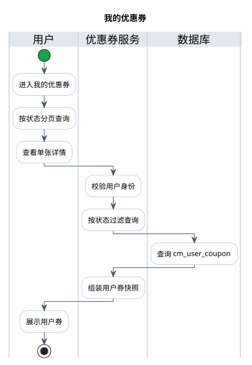

- 流程涉及接口（完整接口定义见「接口设计」用户端 API）：
  - 按状态分页查询优惠券列表：`GET /coupons/me`
  - 查看单张详情：`GET /coupons/me/{id}`
- 校验链（任一失败即终止，错误码见「错误码表」）：
  - 已登录，用户身份从用户上下文解析，不接收 `userId`
  - 查询与查看详情只返回当前用户的券
- 券来源：包含公开领取与新人自动发放的券；展示领取时的核心快照，不受模板后续变更影响。

#### 订单结算使用优惠券

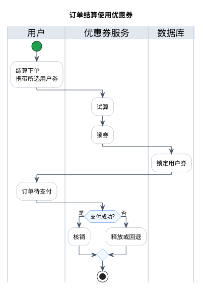

- 流程涉及接口（完整接口定义见「内部服务间 API」）：
  - 试算：`POST /internal/coupon/quote`
  - 锁券：`POST /internal/coupon/lock`
  - 核销：`POST /internal/coupon/commit`
  - 释放：`POST /internal/coupon/release`
  - 回退：`POST /internal/coupon/revert`
- 校验链（任一失败即终止，错误码见「错误码表」）：
  - 用户券属于当前用户
  - 用户券状态为 `AVAILABLE`
  - 未过期：`expire_time` 在有效期内
  - 达到使用门槛：适用金额 ≥ `threshold`（试算时校验）
  - 锁券幂等：同一订单重复 lock 返回原锁定结果
- 结算流程：order-service 先试算（无副作用）→ 锁券 → 订单进入 `PENDING_PAYMENT`。
- 操作涉及的状态转换：
  - 锁券 lock：`AVAILABLE → LOCKED`，绑定订单号和锁定过期时间
  - 核销 commit：`LOCKED → USED`，支付成功后执行
  - 释放 release：`LOCKED → AVAILABLE`，取消/超时后执行，同时释放预占库存
  - 回退 revert：`USED → AVAILABLE`（未过期）或 `USED → EXPIRED`（已过期），全额退款后执行
- 推荐券：结算时自动推荐每店铺一张最大优惠店铺券 + 一张最大优惠平台券，用户可选择其他组合或不使用。

#### 新用户注册自动发放优惠券

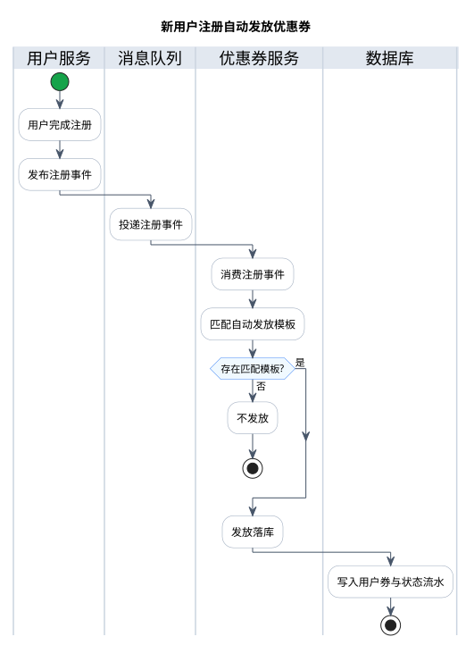

- 用户无感：注册完成后由后端事件驱动自动发放，用户无需主动操作。
- 校验链（任一失败即跳过该模板，错误码见「错误码表」）：
  - 用户类型为 `NORMAL`
  - 模板 `ownerType = PLATFORM` 且 `issueChannel = REGISTER_AUTO`
  - 模板 `status = ACTIVE`
  - 当前处于发放窗口内
  - 未重复发放：`(user_id, coupon_id)` 唯一索引兜底
- 注册事件不追溯历史模板。
- 幂等保证：双重幂等 —— `event_id`（消息消费幂等）+ `(user_id, coupon_id)` 唯一索引（发放幂等）。
- 落库原子性：coupon-service 在同一事务内完成发行数量原子递增、插入用户券与插入状态流水。
- 展示规则：新人券不进入公开券中心（`GET /coupons` 不返回），只在"我的优惠券"（`GET /coupons/me`）中展示。

### 商家端

#### 创建和发布优惠券模板

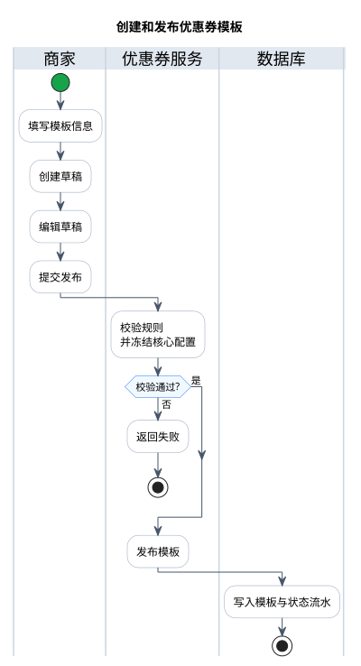

- 流程涉及接口（完整接口定义见「接口设计」商家端 API）：
  - 创建店铺券草稿：`POST /merchant/coupons`
  - 编辑草稿：`PUT /merchant/coupons/{id}`
  - 发布：`POST /merchant/coupons/{id}/publish`
  - 暂停：`POST /merchant/coupons/{id}/pause`
  - 结束：`POST /merchant/coupons/{id}/end`
  - 删除未发放草稿：`DELETE /merchant/coupons/{id}`
- 校验链（任一失败即终止，错误码见「错误码表」）：
  - `ownerType` 强制为 `SHOP`，店铺从当前用户解析唯一店铺，不信任请求参数
  - 模板核心规则发布后冻结，仅草稿可编辑
  - 范围商品必须属于本店
  - 已发放模板不能删除，只能暂停或结束
- 状态转换：创建 → `DRAFT`；发布 → `ACTIVE`；暂停 → `PAUSED`；结束 → `ENDED`；恢复 → `ACTIVE`。

#### 查看和统计优惠券

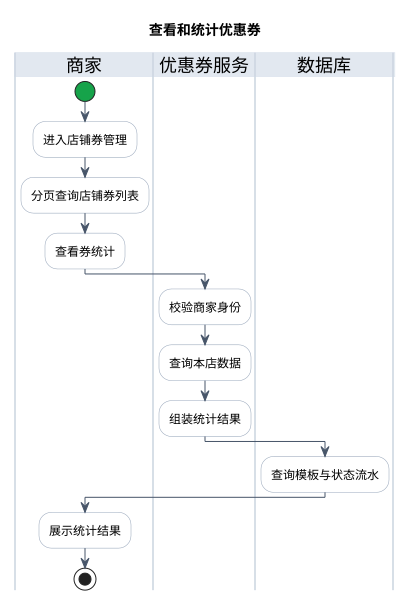

- 流程涉及接口（完整接口定义见「接口设计」商家端 API）：
  - 查询店铺券列表：`GET /merchant/coupons`
  - 查看券统计：`GET /merchant/coupons/{id}/stats`
- 校验链（任一失败即终止，错误码见「错误码表」）：
  - 商家只能查看/操作自己的唯一店铺数据，`shopId` 从当前用户解析，不信任请求参数
- 统计口径：发行/领取/锁定/核销/过期/撤销。
- 商家端限制：不能创建平台券、不能撤销用户券、不能创建新人自动发放券。

### 运营端

#### 创建和发布优惠券模板

流程与「商家端 · 创建和发布优惠券模板」一致，此处仅列出差异：

- 接口路径为 `/operator/coupons`（完整接口定义见「接口设计」运营端 API）。
- `ownerType` 强制为 `PLATFORM`。
- 可创建新人自动发放券：`issueChannel = REGISTER_AUTO` 的平台券，用户注册时自动发放，不进入公开券中心。
- 运营可管理全部平台券和店铺券，但核心规则仍遵循发布后冻结。

#### 查看与统计优惠券

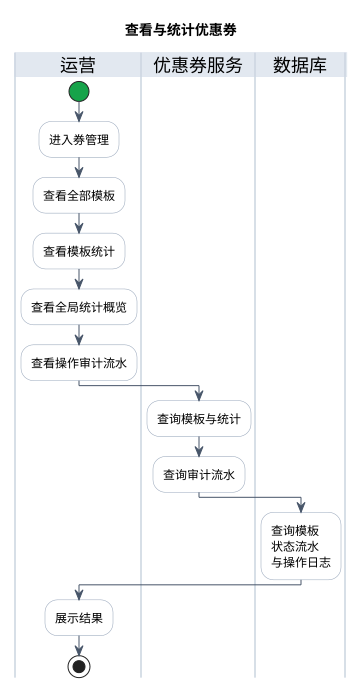

- 流程涉及接口（完整接口定义见「接口设计」运营端 API）：
  - 查询全部模板：`GET /operator/coupons`
  - 查看模板统计：`GET /operator/coupons/{id}/stats`
  - 查看全局统计概览：`GET /operator/coupons/stats/overview`
  - 查看操作审计流水：`GET /operator/coupon-operation-logs`
- 校验链（任一失败即终止，错误码见「错误码表」）：
  - 当前用户为运营角色，权限编码 `coupon:template:view` / `coupon:stats:view`
- 统计口径：模板维度（发行/领取/锁定/核销/过期/撤销）+ 成本维度（平台补贴 + 店铺承担，按订单快照分摊）。
- 费用承担：店铺券商家承担、平台券平台承担。
- 统计来源：用户券流水 + 订单优惠快照，不依赖当前模板字段。

#### 紧急撤销用户券

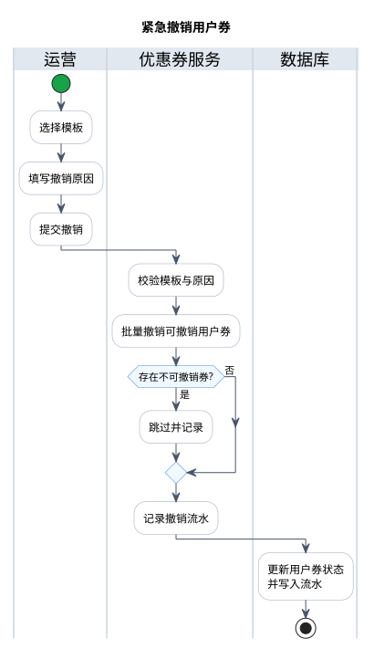

- 流程涉及接口（完整接口定义见「接口设计」运营端 API）：
  - 紧急撤销：`POST /operator/coupons/{id}/revoke`
- 校验链（任一失败即终止，错误码见「错误码表」）：
  - 撤销原因必填
  - 权限编码 `coupon:user:revoke`
- 撤销规则：批量将 `AVAILABLE → REVOKED`；`LOCKED` / `USED` 的券由订单流程处理，不在本次撤销范围。
- 撤销后不可恢复，操作写入模板操作审计流水。

---

## 优惠计算规则

### 计算输入

coupon-service 不查询购物车，也不信任客户端价格。order-service 传入由 product-service 批量查询得到的可信商品快照：

| 字段 | 说明 |
|------|------|
| `sku_id` | SKU ID |
| `product_id` | SPU ID |
| `category_id` | 商品当前分类 ID |
| `shop_id` | 商品所属店铺 ID |
| `unit_price` | 当前可信销售价 |
| `quantity` | 购买数量 |
| `line_amount` | `unit_price × quantity` |

秒杀商品暂时不能够使用优惠券；优惠券只适用于普通商品。

### 适用金额

- 优惠券只抵扣商品明细金额，不处理运费、税费和服务费。
- `ALL`：归属范围内所有符合条件的普通商品。
- `PRODUCT`：商品 ID 命中任一目标 SPU。
- `CATEGORY`：商品分类命中任一目标分类或其后代分类。
- 店铺券的所有命中商品必须属于券归属店铺。
- 门槛基于前一张券处理后的适用商品金额。

### 店铺券计算

对每个店铺子订单：

1. 取该子订单用户选择的店铺用户券；未选择则优惠为 0。
2. 按范围筛选适用明细。
3. 计算适用金额。
4. `threshold = 0` 或适用金额达到门槛时才可用。
5. 满减/立减：优惠金额为 `min(discount_amount, applicable_amount)`。
6. 折扣券：优惠金额为 `applicable_amount × discount_rate`。
7. 将店铺优惠按适用明细金额比例分摊，尾差归最大适用明细。

### 平台券计算

1. 先完成所有店铺券计算。
2. 汇总店铺券后的父订单商品金额。
3. 按平台券范围筛选平台适用金额。
4. 使用店铺券处理后的金额判断平台券门槛。
5. 按平台券类型计算优惠。
6. 将平台优惠按各子订单平台适用金额比例分摊，尾差归最大子订单。
7. 再将每个子订单的平台优惠按适用明细金额比例分摊，尾差归最大适用明细。

### 金额精度

- Java 使用 `BigDecimal`。
- 数据库金额统一 `DECIMAL(18,2)`。
- 折扣比例使用 `DECIMAL(8,6)`。
- 中间计算不提前截断，最终按 2 位小数 `RoundingMode.HALF_UP`。
- 所有优惠金额不超过各自适用金额。
- 明细实付之和必须等于子订单实付之和；子订单实付之和必须等于父订单商品应付金额。
- 运费在商品优惠之后单独加入最终应付金额。

### 推荐券

quote 返回所有合法候选券以及一组最大优惠组合：

- 一张优惠最大的合法平台券；
- 每个店铺子订单一张优惠最大的合法店铺券；
- 优惠金额相同时，优先选择更早过期的券，再按创建时间排序；
- 用户可以不使用券，也可以选择其他合法组合；
- lock 只接受用户最终选择的 `userCouponId`，不自动替换。

---

## 接口设计

### 用户端

| 方法 | 路径 | 说明 | 认证 |
|------|------|------|------|
| GET | `/coupons` | 公开券中心分页查询 | 匿名可访问 |
| GET | `/coupons/{id}` | 查看公开模板详情 | 匿名可访问 |
| POST | `/coupons/{id}/claim` | 当前用户领取，返回用户券 | 需登录 |
| GET | `/coupons/me` | 按状态分页查询我的券 | 需登录 |
| GET | `/coupons/me/{id}` | 查看自己的用户券详情 | 需登录 |

- 用户端不接收 `userId`。`/coupons` 只返回 `issue_channel = PUBLIC_CLAIM` 的模板；新人自动发放模板不进入券中心。
- `/coupons/me` 默认查询 `AVAILABLE`。不提供用户主动删除券。

### 商家端

| 方法 | 路径 | 说明 |
|------|------|------|
| GET | `/merchant/coupons` | 查询当前商家店铺券 |
| POST | `/merchant/coupons` | 创建店铺券草稿 |
| PUT | `/merchant/coupons/{id}` | 编辑草稿 |
| POST | `/merchant/coupons/{id}/publish` | 直接发布（无审核） |
| POST | `/merchant/coupons/{id}/pause` | 暂停发放 |
| POST | `/merchant/coupons/{id}/end` | 结束发放 |
| DELETE | `/merchant/coupons/{id}` | 删除未发放草稿 |
| GET | `/merchant/coupons/{id}/stats` | 查看店铺券统计 |

- 商家端从当前用户解析唯一店铺，不信任请求中的 `shopId`。

### 运营端

| 方法 | 路径 | 说明 |
|------|------|------|
| GET | `/operator/coupons` | 查询全部模板（含平台券和店铺券） |
| POST | `/operator/coupons` | 创建平台券草稿 |
| PUT | `/operator/coupons/{id}` | 编辑草稿 |
| POST | `/operator/coupons/{id}/publish` | 发布平台券 |
| POST | `/operator/coupons/{id}/pause` | 暂停发放 |
| POST | `/operator/coupons/{id}/end` | 结束发放 |
| DELETE | `/operator/coupons/{id}` | 删除未发放草稿 |
| POST | `/operator/coupons/{id}/revoke` | 紧急撤销可撤销用户券 |
| GET | `/operator/coupons/{id}/stats` | 模板统计 |
| GET | `/operator/coupons/stats/overview` | 全局统计概览 |
| GET | `/operator/coupon-operation-logs` | 模板操作审计流水 |

- 运营端可以管理全部平台券和店铺券，但核心规则仍遵循发布后冻结。

### 内部服务间

内部接口不加入网关对外路由，只允许经过服务间认证的 Feign 调用，只允许 order-service 调用。

| 方法 | 路径 | 说明 |
|------|------|------|
| POST | `/internal/coupon/quote` | 无副作用试算 |
| POST | `/internal/coupon/lock` | 重新计算并锁定用户券 |
| POST | `/internal/coupon/commit` | 支付成功核销 |
| POST | `/internal/coupon/release` | 取消/超时释放 |
| POST | `/internal/coupon/revert` | 全额退款回退 |

---

## 权限与数据隔离

权限编码控制"能做什么"，服务层数据权限控制"能操作哪些数据"：

| 权限编码 | 商家 | 运营 | 说明 |
|----------|------|------|------|
| `coupon:template:create` | ✔（限本店） | ✔（全部） | 创建券模板 |
| `coupon:template:view` | ✔（限本店） | ✔（全部） | 查看券模板 |
| `coupon:template:publish` | ✔（限本店） | ✔（全部） | 发布 |
| `coupon:template:pause` | ✔（限本店） | ✔（全部） | 暂停 |
| `coupon:template:end` | ✔（限本店） | ✔（全部） | 结束 |
| `coupon:template:delete` | ✔（限本店） | ✔（全部） | 删除草稿 |
| `coupon:user:view` | ✖ | ✔ | 查看用户券 |
| `coupon:user:revoke` | ✖ | ✔ | 撤销用户券 |
| `coupon:stats:view` | ✔（限本店） | ✔（全部） | 查看统计 |
| `coupon:internal:operate` | ✖ | ✖ | 服务间操作（不对外） |

- 运营角色：全平台范围。
- 商家角色：自己的唯一店铺范围。
- 普通用户：只能访问自己的用户券和公开券。
- 管理端接口必须同时校验 RBAC 和店铺归属。
- `/internal/**` 不对外暴露，使用服务间认证；用户上下文不能替代服务身份认证。

---

## 错误码表

优惠券模块使用 `93xxx` 区间，与项目全局错误码分区保持一致。

| 错误码 | 常量名 | HTTP 状态 | 说明 |
|--------|--------|-----------|------|
| 93001 | `COUPON_TEMPLATE_NOT_FOUND` | 404 | 优惠券模板不存在 |
| 93002 | `COUPON_NOT_CLAIMABLE` | 400 | 当前模板不可领取 |
| 93003 | `COUPON_NOT_STARTED` | 400 | 发放窗口尚未开始 |
| 93004 | `COUPON_ISSUE_ENDED` | 400 | 发放窗口已结束 |
| 93005 | `COUPON_STOCK_NOT_ENOUGH` | 400 | 发行库存不足 |
| 93006 | `COUPON_ALREADY_CLAIMED` | 200 | 内部幂等场景可保留，公开接口重复领取返回成功 |
| 93007 | `USER_COUPON_NOT_FOUND` | 404 | 用户券不存在 |
| 93008 | `USER_COUPON_NOT_BELONG_TO_USER` | 403 | 用户券不属于当前用户 |
| 93009 | `USER_COUPON_EXPIRED` | 400 | 用户券已过期 |
| 93010 | `USER_COUPON_LOCKED` | 409 | 用户券已被其他订单锁定 |
| 93011 | `USER_COUPON_USED` | 400 | 用户券已使用 |
| 93012 | `USER_COUPON_STATE_CONFLICT` | 409 | 状态迁移非法 |
| 93013 | `COUPON_SCOPE_INVALID` | 400 | 适用范围配置无效 |
| 93014 | `COUPON_OWNER_INVALID` | 400 | 券归属不合法 |
| 93015 | `COUPON_RULE_FROZEN` | 400 | 模板核心规则已冻结，不可修改 |
| 93016 | `COUPON_QUOTE_INVALID` | 400 | 优惠试算结果无效 |
| 93017 | `COUPON_LOCK_FAILED` | 409 | 锁券失败 |
| 93018 | `COUPON_OPERATION_NOT_ALLOWED` | 403 | 当前角色或状态不允许操作 |
| 93019 | `COUPON_THRESHOLD_NOT_MET` | 400 | 未达到使用门槛 |
| 93020 | `COUPON_DUPLICATE_CLAIM` | 200 | 重复领取，幂等返回原用户券 |
| 93021 | `COUPON_ISSUE_CHANNEL_INVALID` | 400 | 发放渠道设置不合法 |
| 93022 | `COUPON_VALIDITY_CONFIG_INVALID` | 400 | 有效期配置不合法 |
| 93023 | `COUPON_REGISTER_AUTO_ONLY_PLATFORM` | 400 | 注册自动发放仅限平台券 |
| 93024 | `COUPON_PRODUCT_NOT_BELONG_TO_SHOP` | 400 | 目标商品不属于本店 |
| 93025 | `COUPON_IDEMPOTENT_CONFLICT` | 409 | 幂等键冲突 |

> 价格变化、商品下架、地址不属于用户、库存不足等订单/商品错误继续由对应模块错误码负责（50xxx 订单、20xxx 商品），不在 coupon-service 中重复定义。
