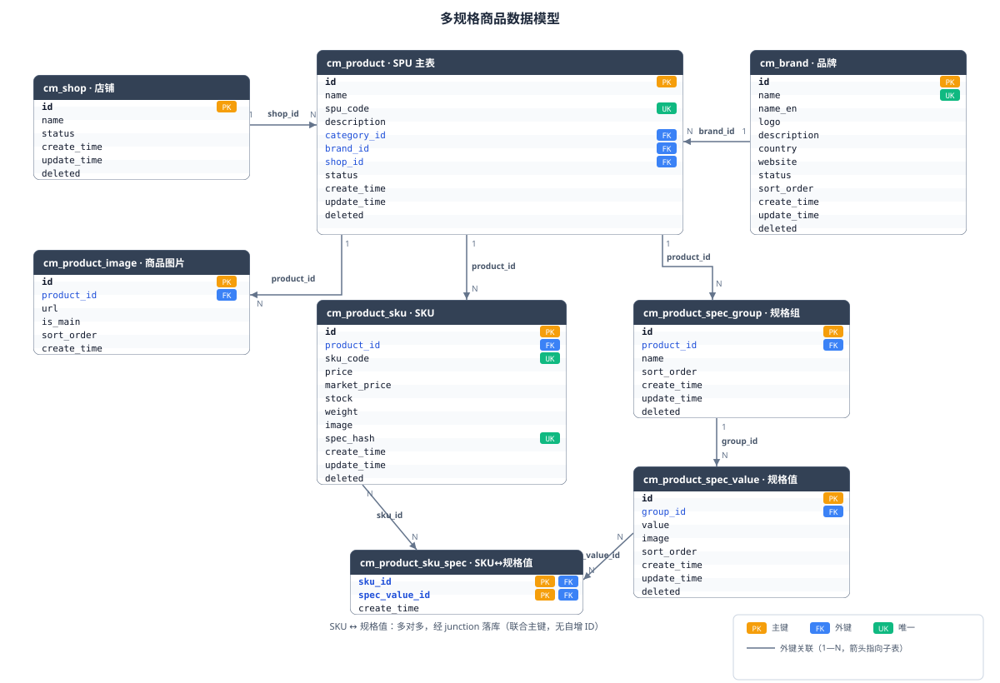
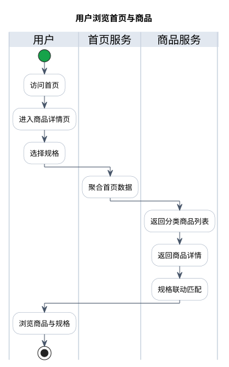
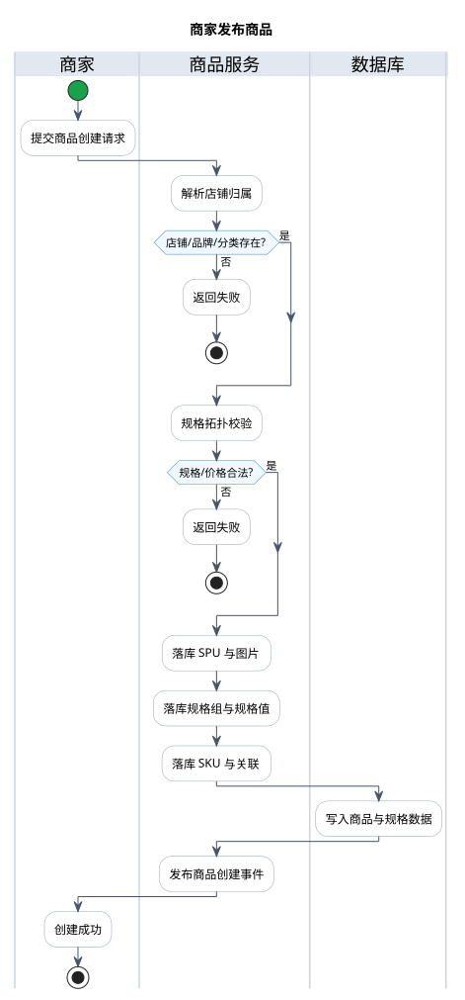

# 商品设计

## 数据库表设计

**模型总览：**

6 张表参与多规格建模（另有 `cm_brand` / `cm_shop` 支撑，`cm_stock_op_log` 库存流水、`cm_favorite` 商品收藏），全部落在单库 `cm_mall`：

| 表 | 角色 |
|----|------|
| `cm_product` | 商品 SPU 主表（无价格/库存/图片指针） |
| `cm_product_sku` | SKU，价格/库存/编码/组合指纹 |
| `cm_product_spec_group` | 规格组（每商品独立） |
| `cm_product_spec_value` | 规格值（挂在组下，可带图） |
| `cm_product_sku_spec` | SKU ↔ 规格值 junction |
| `cm_product_image` | 商品图片（主图 + 轮播，append-only） |

> `cm_brand`（品牌，全局字典）、`cm_shop`（店铺，user-service 维护）为商品支撑表；`cm_stock_op_log` 为普通商品库存操作流水；`cm_favorite` 为商品收藏（user-service 维护）；`cm_category` / `cm_unit` / `cm_comment` / `cm_banner` 为商品周边表，不参与多规格建模。

### cm_product

| 字段 | 类型 | 约束 | 说明 |
|------|------|------|------|
| `id` | bigint | PK, AUTO_INCREMENT | 商品 ID |
| `name` | varchar(200) | NOT NULL | 商品名称 |
| `spu_code` | varchar(50) | UNIQUE, NOT NULL | SPU 编码，服务端生成（`SPU` + Snowflake） |
| `description` | text | NULL | 商品描述 |
| `category_id` | bigint | KEY | 分类 ID → `cm_category.id` |
| `brand_id` | bigint | KEY | 品牌 ID → `cm_brand.id` |
| `shop_id` | bigint | KEY | 所属店铺 ID → `cm_shop.id` |
| `status` | tinyint(1) | NOT NULL, DEFAULT 1 | 上下架状态：`0=DISABLED`（下架）`1=ENABLED`（上架） |
| `create_time` | datetime | NULL | 创建时间 |
| `update_time` | datetime | NULL | 更新时间 |
| `deleted` | tinyint(1) | NOT NULL, DEFAULT 0 | 软删除 |

**索引：**

| 索引名 | 类型 | 字段 |
|--------|------|------|
| PRIMARY | PK | `id` |
| uk_spu_code | UNIQUE | `spu_code` |
| idx_status | KEY | `status` |
| idx_category | KEY | `category_id` |
| idx_brand_id | KEY | `brand_id` |
| idx_shop_id | KEY | `shop_id` |

**约束：**

- **去冗余**：不含 `price` / `stock` / `image` / `images` / 主图指针。列表页价格取 SKU 最低价（应用层 `MIN(price)` 计算），主图按商品 ID 查询图片表（`is_main=1`）获取。
- **SKU 无独立上下架状态**：上下架跟随 SPU，`SkuResp.status` 取自 SPU（`ProductSkuDO` 无状态列）。
- **创建即上架**：创建时状态强制 `ENABLED`，当前无独立上下架接口；删除走软删并发布 `ProductDeleted` 事件。
- **主图单一来源**：`cm_product_image` 中 `is_main=1` 即主图语义，列表/搜索文档均按商品 ID 批量查询图片表取主图，创建逻辑保证首图即主图。

### cm_product_sku

| 字段 | 类型 | 约束 | 说明 |
|------|------|------|------|
| `id` | bigint | PK, AUTO_INCREMENT | SKU ID |
| `product_id` | bigint | NOT NULL | 所属 SPU |
| `sku_code` | varchar(64) | UNIQUE | SKU 编码，服务端生成（`SKU` + Snowflake） |
| `price` | decimal(10,2) | NOT NULL | 销售价 |
| `market_price` | decimal(10,2) | NULL | 划线价，存在时要求 ≥ 售价 |
| `stock` | int | NOT NULL, DEFAULT 0 | 库存数量 |
| `weight` | decimal(10,2) | NOT NULL, DEFAULT 0.00 | 重量（kg） |
| `image` | varchar(500) | NULL | SKU 专属图（可覆盖 SPU 主图） |
| `spec_hash` | varchar(255) | UNIQUE(product_id, spec_hash) | 规格值 ID 升序拼接的组合指纹（见「规格组合防重」） |
| `create_time` | datetime | NULL | 创建时间 |
| `update_time` | datetime | NULL | 更新时间 |
| `deleted` | tinyint(1) | NOT NULL, DEFAULT 0 | 软删除 |

**索引：**

| 索引名 | 类型 | 字段 |
|--------|------|------|
| PRIMARY | PK | `id` |
| uk_sku_code | UNIQUE | `sku_code` |
| uk_product_spec | UNIQUE | `product_id, spec_hash` |
| idx_product_id | KEY | `product_id` |

**约束：**

- **不冗余 `specs_desc` / `sales_count`**：规格描述通过关联表即时拼接（见「SKU 批量查询」），销量未建模。
- **`spec_hash` + `uk_product_spec`** 是组合唯一性的数据库级硬约束，见「规格组合防重」。
- **库存变更语义**：管理端拆分为扣减与回滚两个接口——扣减 `PUT /skus/{skuId}/stock/deduct`（条件更新 `stock >= quantity` 防超卖），回滚 `PUT /skus/{skuId}/stock/release`（无条件加回）；`quantity = 0` 直接成功，扣减库存不足抛 `STOCK_NOT_ENOUGH`。
- **更新差异合并**：按 `spec_hash` 匹配已有 SKU，保留主键/编码/库存，仅刷新价格等销售字段；新增组合插入新 SKU；软删除移除的 SKU 前先清空 `spec_hash` 释放 `uk_product_spec` 唯一槽位，避免该组合后续重新添加时撞软删除行。

### cm_product_spec_group

| 字段 | 类型 | 约束 | 说明 |
|------|------|------|------|
| `id` | bigint | PK, AUTO_INCREMENT | 规格组 ID |
| `product_id` | bigint | NOT NULL | 所属 SPU |
| `name` | varchar(50) | NOT NULL | 规格名，如 "颜色"、"尺码" |
| `sort` | int | NOT NULL, DEFAULT 0 | 排序（前端显示顺序，服务端按下标推导） |
| `create_time` | datetime | NULL | 创建时间 |
| `update_time` | datetime | NULL | 更新时间 |
| `deleted` | tinyint(1) | NOT NULL, DEFAULT 0 | 软删除 |

**索引：**

| 索引名 | 类型 | 字段 |
|--------|------|------|
| PRIMARY | PK | `id` |
| idx_product_id | KEY | `product_id` |

**约束：**

- 规格组**按商品独立维护**，非全局字典——不同商品可自由定义各自的规格维度与取值。
- 组名在创建/更新时由服务端校验**不重复**（归一化后比较，见「文本归一化」）。
- `sort` 由服务端按请求数组下标推导，客户端无需传入。

### cm_product_spec_value

| 字段 | 类型 | 约束 | 说明 |
|------|------|------|------|
| `id` | bigint | PK, AUTO_INCREMENT | 规格值 ID |
| `group_id` | bigint | NOT NULL | 所属规格组 |
| `value` | varchar(100) | NOT NULL | 规格值，如 "红色"、"XL" |
| `image` | varchar(500) | NULL | 规格图（颜色色块/图标） |
| `sort` | int | NOT NULL, DEFAULT 0 | 排序 |
| `create_time` | datetime | NULL | 创建时间 |
| `update_time` | datetime | NULL | 更新时间 |
| `deleted` | tinyint(1) | NOT NULL, DEFAULT 0 | 软删除 |

**索引：**

| 索引名 | 类型 | 字段 |
|--------|------|------|
| PRIMARY | PK | `id` |
| idx_group_id | KEY | `group_id` |

**约束：**

- 规格值**按商品纬度独立**：不同商品的 "红色" 是不同的 `spec_value_id`，引用关系清晰，不共享可变字典。
- 组内规格值由服务端校验**不重复**；`image` 供颜色等可视化规格前端展示色块。

### cm_product_sku_spec

| 字段 | 类型 | 约束 | 说明 |
|------|------|------|------|
| `sku_id` | bigint | PK | → `cm_product_sku.id` |
| `spec_value_id` | bigint | PK | → `cm_product_spec_value.id` |
| `create_time` | datetime | NULL | 创建时间 |

**索引：**

| 索引名 | 类型 | 字段 |
|--------|------|------|
| PRIMARY | PK | `sku_id, spec_value_id` |
| idx_spec_value_id | KEY | `spec_value_id` |

- 联合主键 `(sku_id, spec_value_id)`，**无自增 ID、无业务字段**。
- 支持双向查询：按 `sku_id` 取 SKU 的规格组合；按 `spec_value_id` 反查含某规格值的所有 SKU。
- 更新商品时该表**物理删除重建**（按 SKU 集合删旧行后批量写入新关联），关联表无自增 ID 需要回填，可安全批量写入。

### cm_product_image

| 字段 | 类型 | 约束 | 说明 |
|------|------|------|------|
| `id` | bigint | PK, AUTO_INCREMENT | 图片 ID |
| `product_id` | bigint | NOT NULL | 所属 SPU |
| `url` | varchar(500) | NOT NULL | 图片 URL |
| `is_main` | tinyint(1) | NOT NULL, DEFAULT 0 | 是否主图（0=否 1=是） |
| `sort` | int | NOT NULL, DEFAULT 0 | 排序（详情页轮播顺序） |
| `create_time` | datetime | DEFAULT CURRENT_TIMESTAMP | 创建时间 |

**索引：**

| 索引名 | 类型 | 字段 |
|--------|------|------|
| PRIMARY | PK | `id` |
| idx_product_id | KEY | `product_id` |

- **append-only 语义**：无 `update_time` / `deleted`，图片只追加；更新商品时物理删除旧图后按请求重建（`deleteByProductId` + 批量插入，同一事务）。
- 创建时服务端按下标推导：**首张为主图**（`is_main=1`），`sort` 取下标；查询按 `is_main DESC, sort ASC` 返回，列表页封面与搜索文档主图均取 `is_main=1` 的图片。

### cm_brand

| 字段 | 类型 | 约束 | 说明 |
|------|------|------|------|
| `id` | bigint | PK, AUTO_INCREMENT | 品牌 ID |
| `name` | varchar(100) | UNIQUE, NOT NULL | 品牌名（如 "华为"） |
| `name_en` | varchar(100) | NULL | 品牌英文名 |
| `logo` | varchar(500) | NULL | 品牌 Logo URL |
| `description` | text | NULL | 品牌描述/故事 |
| `country` | varchar(50) | NULL | 品牌国别 |
| `website` | varchar(500) | NULL | 官方网站 |
| `status` | tinyint(1) | NOT NULL, DEFAULT 1 | 启用状态：`0=DISABLED`（禁用）`1=ENABLED`（启用） |
| `sort` | int | NOT NULL, DEFAULT 0 | 展示排序 |
| `create_time` | datetime | NULL | 创建时间 |
| `update_time` | datetime | NULL | 更新时间 |
| `deleted` | tinyint(1) | NOT NULL, DEFAULT 0 | 软删除 |

**索引：**

| 索引名 | 类型 | 字段 |
|--------|------|------|
| PRIMARY | PK | `id` |
| uk_name | UNIQUE | `name` |
| idx_status | KEY | `status` |

- 品牌**独立于分类、全局可用**，不区分厂商/店铺来源；`name` 唯一防止重复录入。

### cm_shop

- 商品必须属于某个店铺：创建商品时服务端通过 `ShopClient.getByUserId`（Feign → user-service）按当前登录用户取店铺，店铺不存在则拒绝创建（`MERCHANT_STORE_NOT_FOUND`）。
- 详情页经 `ShopClient.getShopInfo` 聚合店铺信息（评分/商品数/好评率/关注数），单块获取失败降级为空，不影响其余数据。
- `cm_cart` 已按 `shop_id` 归属，`SkuResp` 携带 `shopId`，为订单/购物车按店聚合提供基础。

### cm_favorite

| 字段 | 类型 | 约束 | 说明 |
|------|------|------|------|
| `id` | bigint | PK, AUTO_INCREMENT | 收藏 ID |
| `user_id` | bigint | NOT NULL | 用户 ID |
| `product_id` | bigint | NOT NULL | 商品 SPU ID |
| `create_time` | datetime | NULL | 创建时间 |
| `update_time` | datetime | NULL | 更新时间 |

**索引：**

| 索引名 | 类型 | 字段 |
|--------|------|------|
| PRIMARY | PK | `id` |
| uk_user_product | UNIQUE | `user_id, product_id` |

**约束与归属：**

- 唯一键 `(user_id, product_id)`：同一用户同一商品至多一条收藏记录，重复收藏由唯一键冲突幂等跳过，取消收藏未命中直接返回。
- 表由 **user-service 维护**（`FavoriteController` / `FavoriteService` / `FavoriteMapper`），收藏接口挂在用户域路径 `/favorites`，网关经 user-service 路由（含 `/products/*/favorite`）；商品收藏属商品域概念，故在本设计中一并说明。
- 收藏后商品下架/软删不影响收藏记录，收藏列表由 user-service 返回商品 ID 集合，商品信息按需经 product-service 批量查询组装。

## 相关工作流

### 用户端

#### 浏览首页与商品

- 流程涉及接口（完整接口定义见「接口设计」）：
  - 首页聚合（user-service `HomeApp`）：`GET /home`
  - 商品详情：`GET /products/{id}/detail`
  - 首页分类商品：`GET /products?categoryIds=&limit=`
  - 规格联动匹配：`POST /skus/match`
- 首页聚合流程：公告 → 轮播图（前 5 条）→ 分类平铺 → 当前整点秒杀活动 → 分类展示商品；一级分类为分组、二级分类为标签，按"标签分类及其三级子分类"经 `HomeProductClient.listByCategory` 一次查询后按标签归属拆分，无商品的标签与分组丢弃，各块失败降级为空列表。
- 详情页流程：五段组装（SPU → 品牌/分类 → 图片 → 规格分组 → SKU 列表）+ 店铺信息与评论摘要聚合（单块失败降级为空）；前端按已选规格值调用 `POST /skus/match` 联动禁用无效组合。
- 校验链（任一失败即终止，错误码见「错误码表」）：
  - 商品存在（`PRODUCT_DETAIL_NOT_FOUND`）
  - 商品上架（查询仅返回 `ENABLED`）
  - 当前网关白名单不含商品浏览端点，浏览需登录；匿名浏览需补充 `auth.whitelist`

#### 收藏商品

- 流程涉及接口（完整接口定义见「接口设计 · 商品收藏」）：
  - 收藏：`POST /favorites/{productId}`
  - 取消收藏：`DELETE /favorites/{productId}`
  - 是否已收藏：`GET /favorites/{productId}`
  - 我的收藏列表：`GET /favorites`
- 校验链（任一失败即终止，错误码见「错误码表」）：
  - 已登录，用户身份从用户上下文解析，不接收 `userId`
  - 收藏/取消收藏幂等：重复收藏由唯一键 `uk_user_product` 冲突跳过，取消未命中直接返回
- 收藏列表只返回商品 ID 集合，商品信息（价格/主图/上下架）由前端按需经 product-service 批量查询组装；商品下架/软删不影响已收藏记录。

#### 评论商品

- 流程涉及接口（完整接口定义见「接口设计 · 周边管理」）：
  - 提交评论：`POST /comments`
  - 评论分页：`GET /comments`
  - 评论摘要：`GET /comments/summary`
- 校验链（任一失败即终止，错误码见「错误码表」）：
  - 已登录（`USER_NOT_AUTHENTICATED`）
  - 商品 ID 必填，评分 1~5，图片最多 5 张（DTO 校验）
- 落库原子性：评论单表插入；摘要按商品可见评论统计综合评分、星级分布与好评/中评/差评三档计数。

### 商家端

#### 发布商品

- 流程涉及接口（完整接口定义见「接口设计 · 商品与 SKU」）：
  - 创建商品：`POST /products`
- 校验链（任一失败即终止，错误码见「错误码表」）：
  - 已登录，店铺从当前用户经 `ShopClient.getByUserId` 解析，店铺不存在拒绝创建（`MERCHANT_STORE_NOT_FOUND`）
  - 品牌/分类存在（`BRAND_NOT_EXIST` / `CATEGORY_NOT_EXIST_OR_NO_ENABLE`）
  - 规格拓扑校验：组数 ≤ 3、组名/组内值不重复、每组至少 1 值、SKU 按组隔离匹配、组合不重复（`SPEC_VALUE_INVALID` / `SKU_SPEC_NOT_MATCH`）
  - 价格校验：售价 > 0，市场价存在时 ≥ 售价
- 落库原子性：单事务落 SPU（`SPU` + Snowflake）+ 图片（首张主图）+ 规格组/规格值（sort 按下标）+ SKU（`SKU` + Snowflake + `spec_hash`）+ junction 关联；`uk_product_spec` 兜底并发重复提交；落库后发布 `ProductCreated` 事务消息（topic `PRODUCT_EVENTS`，search-service 消费）。

#### 编辑商品

- 流程涉及接口（完整接口定义见「接口设计 · 商品与 SKU」）：
  - 更新商品：`PUT /products/{id}`
- 校验链：与创建一致（店铺归属、品牌/分类、规格拓扑、价格）。
- 差异合并语义：按 `spec_hash` 匹配已有 SKU，保留主键/编码/库存，仅刷新价格等销售字段；新增组合插入新 SKU；移除的 SKU 软删前清空 `spec_hash` 释放唯一槽位；图片物理删除重建；发布 `ProductUpdated` 事务消息。

#### 库存与上下架

- 扣减 `PUT /skus/{skuId}/stock/deduct`（条件更新 `stock >= quantity` 防超卖，库存不足抛 `STOCK_NOT_ENOUGH`）、回滚 `PUT /skus/{skuId}/stock/release`（无条件加回）。
- 上下架：当前**无独立上下架接口**，商品创建即上架（状态强制 `ENABLED`）；删除走 `DELETE /products/{id}` 软删并发布 `ProductDeleted` 事件。

### 运营端

#### 基础字典维护

- 流程涉及接口（完整接口定义见「接口设计 · 周边管理」）：
  - 分类：`GET/POST /categories`（平铺/树/详情/批量/创建）
  - 品牌：`GET/POST/PUT/DELETE /brands`（分页、批量软删）
  - 单位：`GET/POST/PUT/DELETE /units`（分页）
  - 轮播图：`GET /banners`、`GET /banners/page`
- 校验链（任一失败即终止，错误码见「错误码表」）：
  - 分类层级 ≤ 最大层级（`CATEGORY_BEYOND_MAX_LEVEL`），子分类 level 由父级推导
  - 品牌名唯一（`uk_name` 兜底重复录入）

## 定时任务

### 商品索引增量同步

1. 按 `updateTime` 游标周期拉取 product-service 商品文档（`GET /products/docs`，时间游标）。
2. 批量 upsert 写入 ES（字段级更新，不覆盖 sales）。
3. 游标存 Redis（最近一次成功同步的最大 `updateTime`），写游标按 `cursorBackoffSeconds` 回退，避免边界漏数据。
4. 首次运行游标初始化为当前时间，存量数据由全量对账任务补齐。
5. 受 `search.sync.incremental.enabled` 控制；翻页达 `maxPages` 上限提前结束。

**每 60 秒执行一次（FIX_DELAY）。**

MQ 增量消费（`ProductCreated / ProductUpdated / ProductDeleted` 事务消息）的兜底数据源，覆盖消息丢失/漏消费场景；删除场景由全量对账任务兜底。

### 商品索引全量对账

1. 按 ID 游标翻页拉取 product-service 全部商品文档（`GET /products/docs`，ID 游标，每页 100 条，`maxPages` 为 0 不限页数）。
2. 批量 upsert 写入 ES（字段级更新，不覆盖 sales），并收集本次全量文档的商品 ID 集合。
3. 拉取 ES 现有全部商品 ID，与 DB 文档 ID 集合求差集，删除 ES 中 DB 已不存在的残留文档（删除兜底）。
4. 受 `search.sync.full.enabled` 控制；返回统计 `total / updated / deleted / failed` 供调度日志与监控。

**每天凌晨 3 点执行一次（CRON `0 0 3 * * ?`）。**

初始化与对账数据源，与增量同步互补：增量负责实时兜底，全量负责存量补齐与残留清理；`ProductDeleted` 消息丢失导致的 ES 残留也由本任务清理。

## 接口设计

### 商品与 SKU

| 方法 | 路径 | 说明 |
|------|------|------|
| POST | `/products` | 创建商品（SPU + 规格 + SKU + 图片，一个请求聚合；店铺由当前用户解析） |
| PUT | `/products/{id}` | 更新商品（差异合并，保留既有 SKU 编码/库存） |
| DELETE | `/products/{id}` | 删除商品（软删，发布 `ProductDeleted`） |
| GET | `/products/{id}/detail` | 详情（品牌/图片/SKU/规格 + 店铺/评论聚合） |
| GET | `/products/{id}` | 商品基本信息（含最低价/主图/品牌/分类） |
| GET | `/products/spu/{spu}` | 按 SPU 编码查询 |
| GET | `/products` | 按分类 ID 集合查询已上架商品（首页分类展示） |
| GET | `/products/docs`、`/products/docs/{id}` | 搜索文档游标拉取/单条（search-service 同步用） |
| PUT | `/skus/{skuId}/stock/deduct` | 扣减库存（条件 `stock >= quantity` 防超卖） |
| PUT | `/skus/{skuId}/stock/release` | 回滚库存（无条件加回） |
| POST | `/skus/batch-query` | SKU 批量查询（购物车/订单/秒杀场景） |
| POST | `/skus/match` | 按已选规格值匹配唯一 SKU（详情页规格联动） |

> 网关路由：`/products/**`、`/skus/**` 经 `product-service` 路由；当前网关白名单不含商品浏览端点，匿名浏览需在 `auth.whitelist` 补充（如 `GET:/products/*`）。

### 内部服务间

内部接口不加入网关对外路由，只允许经过服务间认证的 Feign 调用（`InternalProductClient`，`/internal/product`）。

| 方法 | 路径 | 说明 | 调用方 |
|------|------|------|--------|
| POST | `/internal/product/reserve` | 预占库存（`StockOpReq`，条件扣减） | order-service |
| POST | `/internal/product/confirm` | 支付确认（不改库存，仅落流水） | order-service |
| POST | `/internal/product/release` | 释放库存（取消/超时，幂等） | order-service |
| POST | `/internal/product/compensate` | 补偿释放（补偿任务） | consumer-service |
| POST | `/internal/product/release-by-order` | 按订单释放全部预占库存 | order-service |

### 周边管理

| 方法 | 路径 | 说明 |
|------|------|------|
| GET/POST/PUT/DELETE | `/brands` | 品牌管理（分页、批量软删） |
| GET/POST | `/categories` | 分类（启用平铺/树/详情/批量/创建） |
| GET/POST/PUT/DELETE | `/units` | 单位管理（分页） |
| GET | `/banners`、`/banners/page` | 轮播图 |
| GET/POST | `/comments` | 商品评论（摘要/分页/创建） |

### 商品收藏

| 方法 | 路径 | 说明 |
|------|------|------|
| GET | `/favorites` | 当前用户收藏的商品 ID 列表 |
| GET | `/favorites/{productId}` | 是否已收藏指定商品 |
| POST | `/favorites/{productId}` | 收藏商品（幂等） |
| DELETE | `/favorites/{productId}` | 取消收藏（幂等） |

> 收藏接口挂用户域路径 `/favorites`，由 user-service 提供；`cm_favorite` 表设计见「数据库表设计 · cm_favorite」。

## 权限与数据隔离

商品模块当前不新增 RBAC 权限码，管理端点仅要求登录：

- **店铺归属即数据权限**：创建/更新商品时店铺从当前登录用户经 `ShopClient.getByUserId` 解析（`MERCHANT_STORE_NOT_FOUND` 拒绝），不信任请求参数。
- **下游按店聚合**：`SkuResp.shopId` 透传给订单/购物车，店铺数据隔离由消费侧完成。
- **服务间认证**：`/internal/**` 不对外暴露，用户上下文不能替代服务身份认证。
- **扩展建议**：商家商品管理端点可仿照 coupon/seckill 在网关配置 `url-permissions`（如 `product:manage`），并补充 `cm_resource` / `cm_role_resource` 种子。

## 错误码表

商品模块使用 `20xxx` 区间（`21xxx` 库存），与项目全局错误码分区保持一致。

| 错误码 | 常量名 | HTTP 状态 | 说明 |
|--------|--------|-----------|------|
| 10006 | `MERCHANT_STORE_NOT_FOUND` | 400 | 商户店铺不存在（创建商品前置校验） |
| 20001 | `PRODUCT_OR_SHOP_NOT_EXIST` | 400 | 商品或店铺不存在 |
| 20004 | `SPEC_VALUE_INVALID` | 400 | 规格值无效（组名/组内值重复） |
| 20013 | `CATEGORY_NOT_EXIST_OR_NO_ENABLE` | 400 | 分类不存在 |
| 20017 | `SKU_SPECS_CANNOT_BE_EMPTY` | 400 | SKU 规格不能为空 |
| 20018 | `SKU_SPEC_NOT_MATCH` | 400 | SKU 中包含无效的规格（长度不匹配/跨组引用/组合重复） |
| 20020 | `BRAND_NOT_EXIST` | 400 | 品牌不存在 |
| 20021 | `PRODUCT_DETAIL_NOT_FOUND` | 404 | 商品不存在 |
| 21000 | `STOCK_NOT_ENOUGH` | 400 | 库存不足 |

> 规格 DTO 校验（组数上限、空值、价格下限等）走通用参数校验，不单独定义错误码；价格变化、商品下架、库存不足等订单/购物车侧校验由对应模块错误码负责（50xxx 订单、60xxx 购物车），不在 product-service 中重复定义。
