# 秒杀模块设计

## 数据库表设计

**模型总览：**

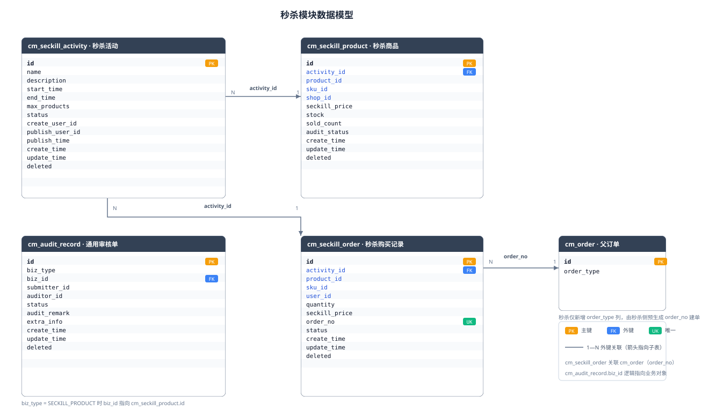

5 张表涉及秒杀建模（另有 `cm_order` 新增一列），全部落在单库 `cm_mall`：

| 表 | 角色 |
|----|------|
| `cm_seckill_activity` | 秒杀活动（主表） |
| `cm_seckill_product` | 秒杀商品（活动商品，SKU 粒度） |
| `cm_seckill_order` | 秒杀购买记录（一人一单） |
| `cm_audit_record` | 统一审核单（当前仅秒杀商品审核） |
| `cm_order` | 父订单（仅新增 `order_type` 列，`NORMAL / SECKILL`） |

### 通用审核单

`cm_audit_record` 表为统一审核单，`biz_type` 可扩展，当前仅用于秒杀商品审核。

| 字段 | 类型 | 约束 | 说明 |
|------|------|------|------|
| `id` | bigint | PK, AUTO_INCREMENT | 审核单 ID |
| `biz_type` | varchar(40) | NOT NULL | 审核对象类型：`SECKILL_PRODUCT`（扩展预留 `SECKILL_ACTIVITY` 等） |
| `biz_id` | bigint | NOT NULL | 审核对象 ID（如秒杀商品 ID） |
| `submitter_id` | bigint | NOT NULL | 提交人用户 ID（商家） |
| `auditor_id` | bigint | NULL | 审核人用户 ID（运营） |
| `status` | varchar(20) | NOT NULL | 审核状态：`PENDING / APPROVED / REJECTED / WITHDRAWN` |
| `audit_remark` | varchar(200) | NULL | 审核意见/驳回原因 |
| `extra_info` | json | NULL | 扩展信息（提交时快照，如 SKU/价格/库存） |
| `create_time` | datetime | NULL | 创建时间 |
| `update_time` | datetime | NULL | 更新时间 |
| `deleted` | tinyint(1) | NOT NULL, DEFAULT 0 | 软删除 |

**索引：**

| 索引名 | 类型 | 字段 |
|--------|------|------|
| PRIMARY | PK | `id` |
| idx_biz | KEY | `biz_type, biz_id, status` |

**约束：**

- 同一 `(biz_type, biz_id)` 同一时刻最多一条 `PENDING`（应用层 + 条件更新保证）。

### 秒杀活动

`cm_seckill_activity` 表为秒杀活动（重构）。

| 字段 | 类型 | 约束 | 说明 |
|------|------|------|------|
| `id` | bigint | PK, AUTO_INCREMENT | 活动 ID |
| `name` | varchar(200) | NOT NULL | 活动名称 |
| `description` | varchar(500) | NULL | 活动描述 |
| `start_time` | datetime | NOT NULL | 开始时间（≥ now + 24h 且为整点；发布后不可改） |
| `end_time` | datetime | NOT NULL | 结束时间（= start_time + 1 小时；发布后不可改） |
| `max_products` | int | NOT NULL, DEFAULT 50 | 每活动最大商品数（创建时可配，范围 1~500；发布后不可改） |
| `status` | varchar(20) | NOT NULL | 活动状态：`DRAFT / PUBLISHED / RUNNING / FINISHED / CANCELLED` |
| `create_user_id` | bigint | NULL | 创建人（运营） |
| `publish_user_id` | bigint | NULL | 发布人（运营），DRAFT 时为 NULL |
| `publish_time` | datetime | NULL | 发布时间，DRAFT 时为 NULL |
| `create_time` | datetime | NULL | 创建时间 |
| `update_time` | datetime | NULL | 更新时间 |
| `deleted` | tinyint(1) | NOT NULL, DEFAULT 0 | 软删除 |

**索引：**

| 索引名 | 类型 | 字段 |
|--------|------|------|
| PRIMARY | PK | `id` |
| idx_status_start | KEY | `status, start_time` |

**约束：**

- 审核相关字段不落业务表，统一在 `cm_audit_record`。
- 发布后文案（name/description）可改，时间（start_time/end_time）与 `max_products` 不可改（要改时间则取消重建）。

### 秒杀商品

`cm_seckill_product` 表为活动商品（重构）。

| 字段 | 类型 | 约束 | 说明 |
|------|------|------|------|
| `id` | bigint | PK, AUTO_INCREMENT | 秒杀商品 ID |
| `activity_id` | bigint | NOT NULL | 所属活动 ID |
| `product_id` | bigint | NOT NULL | SPU ID（冗余，列表展示） |
| `sku_id` | bigint | NOT NULL | SKU ID（下单粒度） |
| `shop_id` | bigint | NOT NULL | 店铺 ID（提交时经 product-service 解析冗余，商家维度/越权） |
| `seckill_price` | decimal(10,2) | NOT NULL | 秒杀价（必须低于 SKU 原价） |
| `stock` | int | NOT NULL | 秒杀剩余库存（运行时权威在 Redis；DB 值在支付确认时落库扣减） |
| `sold_count` | int | NOT NULL, DEFAULT 0 | 已确认售出（支付确认时与 stock 同句 UPDATE +1） |
| `audit_status` | varchar(20) | NOT NULL | 审核状态：`PENDING / APPROVED / REJECTED` |
| `create_time` | datetime | NULL | 创建时间 |
| `update_time` | datetime | NULL | 更新时间 |
| `deleted` | tinyint(1) | NOT NULL, DEFAULT 0 | 软删除 |

**索引：**

| 索引名 | 类型 | 字段 |
|--------|------|------|
| PRIMARY | PK | `id` |
| uk_activity_sku | UNIQUE | `activity_id, sku_id` |
| idx_activity | KEY | `activity_id` |
| idx_shop | KEY | `shop_id` |

**约束：**

- 唯一键 `(activity_id, sku_id)`：同活动同 SKU 唯一。
- 旧表 `product_id` 列保留语义不变，`stock / sold_count / audit_status` 沿用，删除审核人/时间/备注列（迁至审核单）。

### 秒杀购买记录

`cm_seckill_order` 表为秒杀购买记录（新增）。

| 字段 | 类型 | 约束 | 说明 |
|------|------|------|------|
| `id` | bigint | PK | 秒杀单 ID；建议雪花 ID（`IdWorker`），与下单高频插入适配 |
| `activity_id` | bigint | NOT NULL | 活动 ID |
| `product_id` | bigint | NOT NULL | SPU ID（冗余） |
| `sku_id` | bigint | NOT NULL | SKU ID |
| `user_id` | bigint | NOT NULL | 购买用户 ID |
| `quantity` | int | NOT NULL, DEFAULT 1 | 数量（固定 1） |
| `seckill_price` | decimal(10,2) | NOT NULL | 成交价快照 |
| `order_no` | varchar(64) | NULL | 真实订单号（抢购时预生成，consumer 建单后回填确认） |
| `status` | varchar(20) | NOT NULL | 秒杀单状态：`PENDING_PAYMENT / PAID / CANCELLED / REFUNDED` |
| `create_time` | datetime | NULL | 创建时间 |
| `update_time` | datetime | NULL | 更新时间 |
| `deleted` | tinyint(1) | NOT NULL, DEFAULT 0 | 软删除 |

**索引：**

| 索引名 | 类型 | 字段 |
|--------|------|------|
| PRIMARY | PK | `id` |
| uk_activity_sku_user | UNIQUE | `activity_id, sku_id, user_id` |
| idx_user | KEY | `user_id` |
| idx_order_no | KEY | `order_no` |

**约束：**

- 唯一键 `(activity_id, sku_id, user_id)`：权威一人一单。

### 父订单加列

`cm_order` 表仅新增一列，不改既有约束；秒杀单 `order_no` 由秒杀侧预生成传入。

| 字段 | 类型 | 约束 | 说明 |
|------|------|------|------|
| `order_type` | varchar(20) | NOT NULL, DEFAULT 'NORMAL' | 订单类型：`NORMAL / SECKILL` |

---

## 状态流转

### 活动状态机

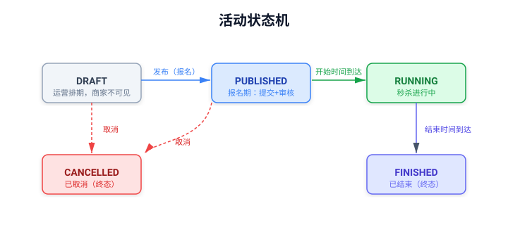

**合法迁移（`SeckillActivityStateTransitions`，对齐 order 的 `ParentOrderStateTransitions` 风格）：**

- `DRAFT → PUBLISHED / CANCELLED`
- `PUBLISHED → RUNNING / CANCELLED`
- `RUNNING → FINISHED`
- `FINISHED / CANCELLED` 终态

**关键规则：**

- **发布 = 开放报名**：DRAFT 阶段商家不可见、不可提交商品；发布后进入报名期。
- **报名截止 = start_time**：RUNNING 后自动不可提交，不加 `signup_deadline` 字段。
- **商品提交限制**：仅 `PUBLISHED` 且 `start_time > now` 的活动可提交商品。
- **发布前置**：状态 DRAFT + 信息完整（name/description 非空）+ `start_time > now`；不要求已有已审核商品（商家报名后才会有）。
- **发布后可改**：文案（name/description）可改，时间（start_time/end_time）不可改（要改时间则取消重建）。
- **取消**：DRAFT/PUBLISHED 可取消（终态不可恢复）；RUNNING/FINISHED 不可取消；副作用为预热 job 清 Redis key、`cm_seckill_product` 记录保留。
- **自动流转**：xxl-job `seckillActivityStatus` 每分钟扫描。

### 商品审核状态机

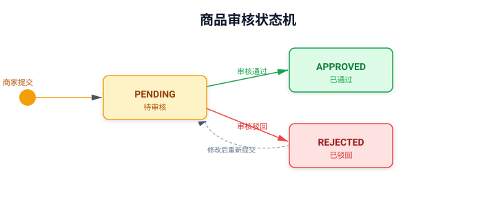

- 审核动作：新建 `cm_audit_record`（PENDING）→ 运营审核更新记录（APPROVED/REJECTED）并同步 `cm_seckill_product.audit_status`。
- 同一商品重新提交：将 `audit_status` 置回 `PENDING`，原审核单如为 PENDING 先撤回（WITHDRAWN），再新建审核单。

### 秒杀订单状态机

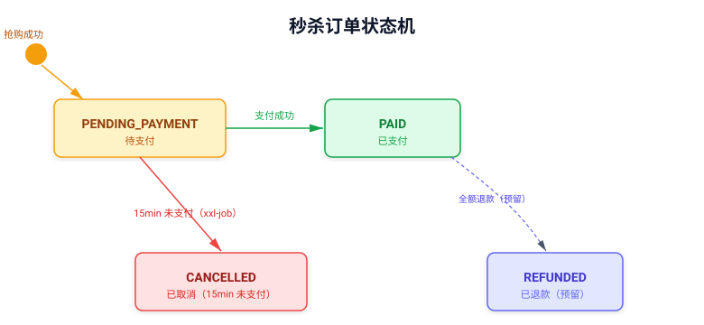

- `REFUNDED`：预留（全额退款事件回退时使用，本期不实现秒杀退款入口）。

---

## 相关工作流

### 用户端

#### 浏览进行中活动

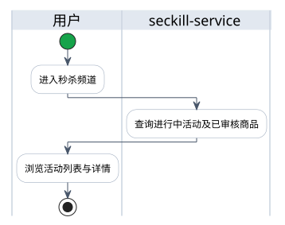

- 流程涉及接口（完整接口定义见「接口设计」用户端 API）：
  - 进行中活动列表：`GET /seckill/activities`
  - 活动详情 + 已审核商品：`GET /seckill/activities/{id}`
- 校验链（任一失败即终止，错误码见「错误码表」）：
  - 免登录（gateway 白名单）
  - 用户端只返回 `RUNNING` 状态活动

#### 抢购下单

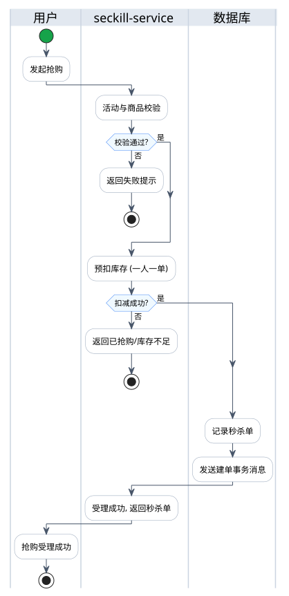

- 流程涉及接口（完整接口定义见「接口设计」用户端 API）：
  - 抢购：`POST /seckill/purchase`（`activityId` + `skuId` + `addressId`）
- 校验链（任一失败即终止，错误码见「错误码表」）：
  - 黑名单拦截：`seckill:blacklist:{userId}` 存在 → 限流错误
  - 限流校验：`seckill:rate:{userId}` 固定窗口 1 分钟 10 次；超阈值 30 次/分钟 → 写入黑名单（TTL 24h）
  - 活动存在且 `RUNNING`
  - 商品已 `APPROVED` 且属于该活动
  - 抢购必须携带 `addressId`（建单时快照进 `cm_order.address_snapshot`）
- 用户身份：用户端不传 `userId`，统一从 `UserContextHolder` 获取。
- 一人一单：固定限购 1，Redis `SETNX`（`seckill:user:{activityId}:{skuId}:{userId}`）+ DB 唯一键 `(activity_id, sku_id, user_id)` 双保险。
- 抢购返回：立即返回秒杀单 ID + `orderNo`（受理成功），不阻塞等真实订单。

**Redis Key 设计：**

| Key | 类型 | 说明 |
|-----|------|------|
| `seckill:stock:{activityId}:{skuId}` | string | 秒杀剩余库存（并发控制镜像，预热 SET NX 取自 DB stock，抢购 DECR 预扣，超时 INCR 归还） |
| `seckill:user:{activityId}:{skuId}:{userId}` | string | 一人一单标记（SETNX，TTL = 活动结束时刻） |
| `seckill:rate:{userId}` | string | 限流计数器（固定窗口，1 分钟） |
| `seckill:blacklist:{userId}` | string | 自动黑名单标记（限流超阈值写入，TTL 24h） |

**抢购 Lua（单脚本原子）：**

```
KEYS[1] = seckill:stock:{activityId}:{skuId}
KEYS[2] = seckill:user:{activityId}:{skuId}:{userId}
ARGV[1] = quantity (固定 1)
ARGV[2] = userFlagTtlSeconds

1. if EXISTS KEYS[2] then return -2 end   -- 已抢购
2. local stock = GET KEYS[1]
3. if not stock or tonumber(stock) < tonumber(ARGV[1])
   then return -3 end                      -- 库存不足
4. DECRBY KEYS[1] ARGV[1]
5. SET KEYS[2] 1 EX ARGV[2] NX
6. return 1
```

- 返回码映射：`-2 → 已抢购`、`-3 → 库存不足`、`1 → 成功`。

**抢购主流程（seckill-service `SeckillApp.purchase`）：**

```
用户请求
  → 黑名单拦截（seckill:blacklist:{userId} 存在 → 限流错误）
  → 限流校验（seckill:rate:{userId}，1 分钟 10 次；超阈值 30 次/分钟 → 写入黑名单 TTL 24h）
  → 活动存在且 RUNNING
  → 商品已 APPROVED 且属于该活动
  → Lua 原子扣减（一人一单 + 库存）
       ├─ 返回 -2（已抢购）→ 排队失败提示
       ├─ 返回 -3（库存不足）→ 排队失败提示
       └─ 返回 1（成功）
  → 预生成 orderNo（SK + IdWorker）
  → 插入 cm_seckill_order（唯一键权威防重）
      ├─ 唯一键冲突 → Lua 回补（INCR stock + DEL user flag）→ 抛已抢购
      └─ 成功 → 发送建单事务消息（同事务）
  → 返回秒杀单 ID + orderNo（受理成功，异步建单）
```

- 排队失败：非异步排队，是校验阶段失败提示统称（一人一单/库存不足/窗口未开）。
- 事件负载 `SeckillOrderCreateEvent`：`orderNo`、`seckillOrderId`、`userId`、`skuId`、`productId`、`seckillPrice`、`quantity`、`addressId`。

**异步建单消息流（RocketMQ 半事务消息）：**

```
抢购成功
  └─ 落库 cm_seckill_order + 发送建单事务消息（sendInTransaction, topic=SECKILL_ORDERS, tag=SeckillOrderCreate）
       └─ 半事务消息：本地事务由 SeckillTxMessageListener 执行，按 orderNo 回查
            └─ consumer-service SeckillOrderConsumer
                 └─ handler: SeckillOrderCreateHandler
                      └─ Feign → order-service POST /internal/seckill-orders
                           └─ 建单成功/幂等成功 → 回填 cm_seckill_order.order_no
```

- 消息可靠性：RocketMQ 半事务消息保证落库与消息发布一致，重试/死信兜底，consumer 按 `orderNo` 幂等（业务层幂等：订单号唯一键）。
- order-service 建单按 `order_no` 唯一键幂等：重复插入捕获 DuplicateKey → 查询已有订单返回。

#### 查看我的秒杀单

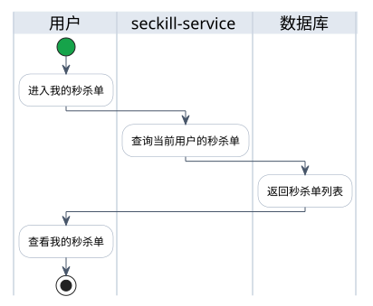

- 流程涉及接口（完整接口定义见「接口设计」用户端 API）：
  - 我的秒杀单：`GET /seckill/orders`（分页，按 userId）
- 校验链（任一失败即终止，错误码见「错误码表」）：
  - 已登录，用户身份从用户上下文解析，不接收 `userId`
  - 查询只返回当前用户的秒杀单

### 商家端

#### 提交秒杀商品

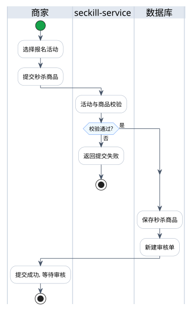

- 流程涉及接口（完整接口定义见「接口设计」商家端 API）：
  - 可报名活动列表：`GET /seckill/merchant/activities`
  - 报名活动详情：`GET /seckill/merchant/activities/{id}`
  - 提交商品：`POST /seckill/activities/{activityId}/products`
  - 我的提交列表：`GET /seckill/merchant/products`
- 校验链（任一失败即终止，错误码见「错误码表」）：
  - 活动状态为 `PUBLISHED` 且 `start_time > now`（DRAFT 阶段商家不可见，列表与详情均只返回 PUBLISHED）
  - 服务端经 product-service 校验 SKU 存在/上架，解析 `product_id`、`shop_id`、原价
  - 秒杀价 < SKU 原价
  - 提交库存 ≤ SKU 库存
  - 同活动同 SKU 唯一
- 审核落库：同一事务内新建 `cm_audit_record`（PENDING）+ 更新 `cm_seckill_product.audit_status = PENDING`；原审核单如为 PENDING 先撤回（WITHDRAWN）。

### 运营端

#### 创建与发布活动

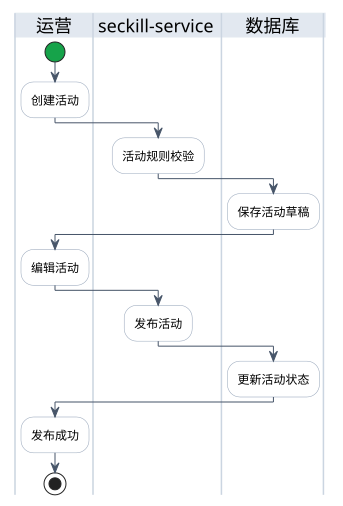

- 流程涉及接口（完整接口定义见「接口设计」运营端 API）：
  - 创建活动：`POST /seckill/activities`
  - 编辑活动：`PATCH /seckill/activities/{id}`
  - 发布活动：`POST /seckill/activities/{id}/publish`
- 校验链（任一失败即终止，错误码见「错误码表」）：
  - 时长必须 1 小时
  - 开始时间必须晚于当前 24 小时且为整点
  - 每活动商品数上限创建时可配（默认 50，范围 1~500）
  - 发布前置：状态 DRAFT + 信息完整（name/description 非空）+ `start_time > now`；不要求已有已审核商品
- 状态转换：创建 → `DRAFT`；发布 → `PUBLISHED`（开放商家报名）。
- 活动免审：运营建活动 → 发布 → 自动运行/结束，不做活动审核。

#### 取消活动

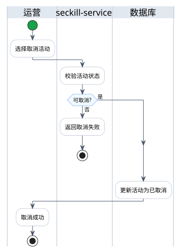

- 流程涉及接口（完整接口定义见「接口设计」运营端 API）：
  - 取消活动：`POST /seckill/activities/{id}/cancel`
- 校验链（任一失败即终止，错误码见「错误码表」）：
  - 仅 `DRAFT / PUBLISHED` 可取消（终态不可恢复）；`RUNNING / FINISHED` 不可取消
- 副作用：预热 job 清 Redis key，`cm_seckill_product` 记录保留。

#### 审核秒杀商品

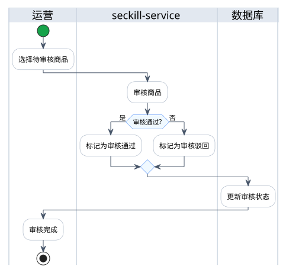

- 流程涉及接口（完整接口定义见「接口设计」运营端 API）：
  - 待审/全部商品列表：`GET /seckill/operator/products`（分页，按 audit_status）
  - 审核商品：`PATCH /seckill/activities/{activityId}/products/{productId}`
- 校验链（任一失败即终止，错误码见「错误码表」）：
  - 审核对象当前状态允许审核（`PENDING`）
  - 同一对象最多一条 `PENDING` 审核单
- 落库原子性：更新 `cm_audit_record`（APPROVED/REJECTED）+ 同步 `cm_seckill_product.audit_status`。

### 系统机制

#### Redis 预热（xxl-job `seckillCachePreheatJob`，每分钟）

- 扣减模型：**扣的是秒杀池自身 `cm_seckill_product.stock`**，不联动真实 SKU 库存。三层：预热 `SET NX`（DB 初始值）→ 抢购 Redis `DECR` 预扣（并发控制）→ 支付落库扣减 DB stock（最终一致）；超时未付 DB 未扣过无需回补，Redis 归还。
- 预热提前量：**30 分钟**（`start_time - 30min` 起预热，与报名截止 = start_time 联动，报名期审核通过的商品在开始前有充足时间预热）。
- 扫描 `PUBLISHED / RUNNING` 且 `start_time <= now + 30min` 的活动商品：
  - 库存 key 不存在 → `SET NX`（取自 `cm_seckill_product.stock`）。
  - 库存 key 已存在 → 不覆盖（保留 Redis 运行时值）。
- 扫描 `FINISHED / CANCELLED` 活动商品：删除对应 stock / user key。
- 一致性：支付落库后 DB `stock` 变小不影响 Redis——抢购时 Redis 已 `DECR` 同步预扣，`SET NX` 不覆盖恰好保留运行时值；Redis 与 DB 在支付落库/超时归还后始终一致（见「支付确认与超时释放」）。

#### 支付确认与超时释放

**支付确认（confirmPaid，消费 OrderPaid 事件，单事务）：**

```
① UPDATE cm_seckill_order SET status='PAID'
   WHERE id=? AND status='PENDING_PAYMENT'
   影响行数 = 0 → 幂等跳过（已 PAID / 已 CANCELLED）
② UPDATE cm_seckill_product
   SET stock = stock - 1, sold_count = sold_count + 1
   WHERE id=? AND stock >= 1          -- 条件防负库存兜底
```

只有状态迁移成功才落库扣减，重复支付事件不会重复扣。

**支付消息流（RocketMQ）：**

```
支付成功（order-service 模拟入口）
  └─ OrderPaid 事件（ORDER_EVENTS, tag=OrderPaid）
       └─ consumer-service OrderEventConsumer
            └─ handler: SeckillOrderPaidHandler（新增）
                 └─ Feign → seckill-service POST /seckill/internal/confirm-paid {orderNo}
                      └─ 单事务：cm_seckill_order PENDING_PAYMENT→PAID +
                               cm_seckill_product stock-1 / sold_count+1（WHERE stock>=1）
```

**超时未付（xxl-job `seckillOrderTimeoutRecoveryJob`，每分钟，扫描 15min 未支付）：**

```
① 条件更新 cm_seckill_order SET status='CANCELLED'
   WHERE id=? AND status='PENDING_PAYMENT'
   影响行数 = 0 → 跳过（已被支付确认或已取消）
② 影响行数 > 0 才 Redis INCR 归还秒杀池      -- 先状态后归还，防竞态多还
③ Feign → order-service POST /internal/order/cancel（幂等，复用现有）
```

支付确认与超时 job 在 15min 边界的竞态由状态条件更新吃掉：谁先置状态谁赢，后到者 `WHERE status='PENDING_PAYMENT'` 影响行数 0 直接跳过；DB `stock` 超时时未扣过，无需回滚库存。

#### Sentinel 整体限流

与按用户 Redis 限流并存，职责分层：Redis 管按用户频率，Sentinel 管整体水位。

| 位置 | 规则 | 兜底 |
|------|------|------|
| gateway | `/seckill/**` 路由整体 QPS 200（Nacos `gateway-flow-rules`，快速失败） | 自定义 BlockRequestHandler → HTTP 429 + 错误码 1005 |
| seckill-service | `seckill:purchase` QPS 200（Nacos `seckill-service-flow-rules`） | `purchaseBlockHandler` 抛 1005 |

规则全部走 Nacos 动态数据源（`spring.cloud.sentinel.datasource.*`），改阈值不重启；Sentinel dashboard（compose `sentinel-dashboard`，8858）只做监控，规则修改一律在 Nacos 完成，避免两套写入源互相覆盖。错误码 1005 `FLOW_CONTROL_BLOCKED` 表示被限流，92004 仍表示按用户 Redis 限流。

---

## 定时任务

秒杀模块共三个定时任务，均每分钟执行一次，覆盖活动流转、缓存预热与订单超时回收三条独立链路。

### 活动状态流转

1. 将已到开始时间的报名中活动流转为进行中。
2. 将已到结束时间的进行中活动流转为已结束。

**每分钟执行一次。**

条件更新保证并发安全，重复执行不会越过状态机。

### 缓存预热与清理

1. 预热：为临近开始（30 分钟内）的活动商品写入库存缓存，仅当缓存不存在时写入（取自 DB 库存，不覆盖运行时值）。
2. 清理：删除已结束/取消活动的库存缓存（一人一单标记随 TTL 自然过期，无需清理）。

**每分钟执行一次。**

### 秒杀单超时回收

1. 扫描超过 15 分钟未支付的秒杀单。
2. 逐单取消：已被支付确认的秒杀单跳过。
3. 仅取消成功的秒杀单归还库存，保留一人一单标记（秒杀单行仍在，唯一键继续拦截重复下单）。
4. 幂等取消对应真实订单，失败等待下轮补偿。

**每分钟执行一次。**

与支付确认的竞态由条件更新吃掉：谁先置状态谁赢，后到者直接跳过，避免多还库存。

---

## 接口设计

### 用户端

| 方法 | 路径 | 说明 | 认证 |
|------|------|------|------|
| GET | `/seckill/activities` | 进行中活动列表（RUNNING，分页） | 匿名可访问（gateway 白名单） |
| GET | `/seckill/activities/{id}` | 活动详情 + 已审核商品 | 匿名可访问 |
| POST | `/seckill/purchase` | 抢购（`activityId` + `skuId` + `addressId`） | 需登录 |
| GET | `/seckill/orders` | 我的秒杀单（分页，按 userId） | 需登录 |

请求示例：

```
POST /seckill/purchase
{
  "activityId": 1,
  "skuId": 101,
  "addressId": 5
}
→ Result<PurchaseResp> { "seckillOrderId": 10001, "orderNo": "SK172700000000001", "status": "PENDING_PAYMENT" }
```

- 用户端不接收 `userId`，统一从 `UserContextHolder` 获取。

### 商家端

| 方法 | 路径 | 说明 | 认证 |
|------|------|------|------|
| GET | `/seckill/merchant/activities` | 可报名活动列表（PUBLISHED 报名期，分页） | 需登录 + `seckill:product:view` |
| GET | `/seckill/merchant/activities/{id}` | 报名活动详情（PUBLISHED，含已审商品） | 需登录 + `seckill:product:view` |
| POST | `/seckill/activities/{activityId}/products` | 提交商品（`skuId` + `seckillPrice` + `stock`；仅 PUBLISHED 且未开始） | 需登录 + `seckill:product:submit` |
| GET | `/seckill/merchant/products` | 我的提交列表（按 shopId 分页） | 需登录 + `seckill:product:view` |

- DRAFT 阶段商家不可见（列表与详情均只返回 PUBLISHED）。

### 运营端

| 方法 | 路径 | 说明 | 认证 |
|------|------|------|------|
| POST | `/seckill/activities` | 创建活动（复用 `ActivityCreateReq`，强校验规则） | `seckill:activity:create` |
| PATCH | `/seckill/activities/{id}` | 编辑活动（DRAFT 可改全字段；PUBLISHED 仅文案 name/description，时间不可改） | `seckill:activity:create` |
| GET | `/seckill/operator/activities` | 活动分页列表（`SeckillActivityPageReq`：status + 分页，`@QueryCondition` 注解驱动） | `seckill:activity:view` |
| POST | `/seckill/activities/{id}/publish` | 发布活动（DRAFT→PUBLISHED，开放报名） | `seckill:activity:publish` |
| POST | `/seckill/activities/{id}/cancel` | 取消活动（DRAFT/PUBLISHED→CANCELLED，终态） | `seckill:activity:cancel` |
| GET | `/seckill/operator/products` | 待审/全部商品列表（分页，按 audit_status） | `seckill:product:view` |
| PATCH | `/seckill/activities/{activityId}/products/{productId}` | 审核商品（`ActivityProductAuditReq`，写 `cm_audit_record`） | `seckill:product:audit` |

### 内部服务间

内部接口不加入网关对外路由，只允许经过服务间认证的 Feign 调用。

**seckill-service 内部接口（`/seckill/internal`）：**

| 方法 | 路径 | 说明 | 调用方 |
|------|------|------|--------|
| GET | `/seckill/internal/activities/{activityId}/products/{productId}/verification` | 校验已审核商品（已有） | 预留 |
| POST | `/seckill/internal/confirm-paid` | 支付成功确认：单事务 PAID + 落库扣减 `stock-1`/`sold_count+1`（WHERE stock>=1） | consumer-service |
| GET | `/seckill/internal/orders/{orderNo}` | 按真实订单号查秒杀单 | consumer/order 侧对账 |

**order-service 内部建单（`/internal/seckill-orders`）：**

| 方法 | 路径 | 说明 |
|------|------|------|
| POST | `/internal/seckill-orders` | 建秒杀单：跳过购物车/券/库存，SKU 快照 + 秒杀价，单事务 CREATING→PENDING_PAYMENT |

- 请求（`SeckillOrderCreateReq`）：`orderNo`（秒杀侧预生成）、`userId`、`addressId`、`skuId`、`productId`、`seckillPrice`、`quantity`。
- 响应：`OrderResp`（含 orderNo、payableAmount）。
- order-service 内部流程：`SkuClient.listSkusByIds` 取可信快照 → 建 `OrderDO(order_type=SECKILL, status=PENDING_PAYMENT)` + `OrderSubDO(PENDING_SHIPMENT)` + `OrderItemDO(unitPrice=seckillPrice)`，同一事务，不做库存预占/锁券/购物车清理。
- 幂等：`uk_order_no` 重复 → 查询返回已有订单。

## 权限与数据隔离

权限编码控制"能做什么"，服务层数据权限控制"能操作哪些数据"：

| 权限编码 | 商家 | 运营 | 用户 | 说明 |
|----------|------|------|------|------|
| `seckill:activity:create` | ✖ | ✔ | ✖ | 创建/编辑活动 |
| `seckill:activity:publish` | ✖ | ✔ | ✖ | 发布活动 |
| `seckill:activity:cancel` | ✖ | ✔ | ✖ | 取消活动 |
| `seckill:activity:view` | ✖ | ✔ | ✖ | 活动查询 |
| `seckill:product:submit` | ✔（限本店） | ✖ | ✖ | 提交秒杀商品 |
| `seckill:product:audit` | ✖ | ✔ | ✖ | 审核秒杀商品 |
| `seckill:product:view` | ✔（限本店） | ✔（全部） | ✖ | 秒杀商品查询 |
| `seckill:order:view` | ✖ | ✔ | ✖ | 秒杀订单查询 |

**权限资源种子（`cm_resource` 追加）：**

| code | name |
|------|------|
| `seckill:activity:create` | 秒杀活动创建 |
| `seckill:activity:publish` | 秒杀活动发布 |
| `seckill:activity:cancel` | 秒杀活动取消 |
| `seckill:activity:view` | 秒杀活动查询 |
| `seckill:product:submit` | 秒杀商品提交 |
| `seckill:product:audit` | 秒杀商品审核 |
| `seckill:product:view` | 秒杀商品查询 |
| `seckill:order:view` | 秒杀订单查询 |

- 追加 `cm_role_resource` 绑定 admin；`seckill:manage`(50) 保留。
- 运营角色：全平台范围。
- 商家角色：自己的唯一店铺范围（`shopId` 从当前用户解析，不信任请求参数）。
- 普通用户：只能访问自己的秒杀单和进行中活动。
- `/internal/**` 不对外暴露，使用服务间认证；用户上下文不能替代服务身份认证。

---

## 错误码表

秒杀模块使用 `92xxx` 区间，审核复用 `90xxx`，与项目全局错误码分区保持一致。

**复用（已存在）：** 92000/92001/92002/92003/92004/92005/92006/92012/92013/92014/92015/92016/92017/92024/92026/92027/92030/92031，90000–90018（审核）。

**补充建议（`BizErrorEnum` 追加）：**

| 错误码 | 常量名 | 说明 |
|--------|--------|------|
| 92032 | `SECKILL_ACTIVITY_ALREADY_PUBLISHED` | 活动已发布，不能重复发布 |
| 92033 | `SECKILL_ACTIVITY_NOT_PUBLISHABLE` | 当前状态不可发布 |
| 92034 | `SECKILL_ACTIVITY_NOT_CANCELLABLE` | 当前状态不可取消 |
| 92035 | `SECKILL_PRODUCT_NOT_SUBMITTABLE` | 活动状态不允许提交商品 |
| 92036 | `SECKILL_ADDRESS_REQUIRED` | 抢购必须选择收货地址 |
| 92037 | `SECKILL_ORDER_TIMEOUT_CANCEL_FAILED` | 秒杀单超时取消失败（job 告警用，可省略） |
| 90019 | `AUDIT_ALREADY_PENDING` | 该对象已有待审核记录 |
| 90020 | `AUDIT_TARGET_STATUS_CONFLICT` | 审核对象当前状态不允许审核 |

> 价格变化、商品下架、地址不属于用户、库存不足等订单/商品错误继续由对应模块错误码负责（50xxx 订单、20xxx 商品），不在 seckill-service 中重复定义。
