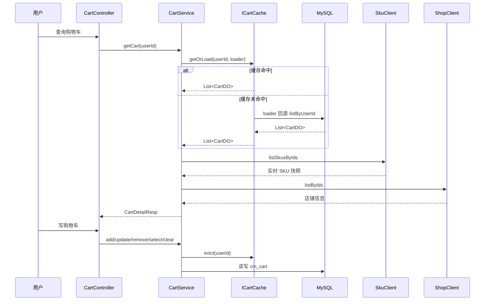

# 购物车架构设计

## 架构总览

- **入口**：`CartController` 接收购物车增删查改与选中状态请求，只做参数接收和调用 `ICartService`，不写业务规则。
- **领域服务**：`CartService` 实现 `ICartService`，负责购物车记录的合并、容量控制、选中状态、缓存失效与响应组装。
- **权威数据源**：`cm_cart` 是购物车数据的唯一权威。防重复、容量复核和下单取已选条目都必须读数据库，不能依赖缓存。
- **缓存实现**：已引入 Spring Cache 注解框架，`RedisCartCache` 通过 `@Cacheable` / `@CacheEvict` 实现缓存；`CartCacheConfig` 配置 RedisCacheManager、JSON 序列化和缓存异常降级。
- **唯一约束**：`uk_user_sku (user_id, sku_id)` 保证同一用户同一 SKU 只有一条记录，是防重复的最终权威。
- **实时信息**：商品价格、名称、库存、店铺从 `SkuClient` / `ShopClient` 实时获取；缓存和 `CartDO` 只保存加入时的快照，不作为权威价格与可售状态。
- **读模型**：`getCart` 先通过 `ICartCache.getOrLoad` 读缓存，未命中再查数据库并回填；随后仍用 SKU/店铺实时信息富化、分组并汇总。**不缓存 `CartDetailResp`**，避免可用性、小计、价格随库存和价格变化而失真。
- **下单衔接**：`ICartService.listSelectedItems` 被订单结算步骤读取；这条链路直接读数据库、绕过缓存，避免陈旧的选中状态影响下单。订单落库后由管道收尾步骤 `REMOVE_ORDERED_CART_ITEMS` 调用 `removeItems` 清理已下单项并失效缓存，失败只记日志不影响订单。
- **物理删除**：`cm_cart` 没有 `deleted` 字段，删除即物理删除，唯一键可被真正释放，便于用户重新加入同一 SKU。




## 缓存键与值

```text
Spring Cache name: cart:items
key:               cart:items::${userId}（keyPrefix 为空时）
value:             List<CartDO> 的 JSON 数组
TTL:               cloudmall.cart.cache.ttl，默认 5 分钟
```

空购物车也缓存为空数组，避免空车用户反复穿透到数据库。缓存未命中时 `ICartCache` 通过传入的 loader 回源数据库。

当前使用 Spring Cache 注解框架，TTL 由 `RedisCacheManager` 统一配置，不实现逐 key 随机抖动；这是简化实现带来的取舍。

## 写入一致性：防重复与容量控制

添加购物车仍采用"数据库唯一键 + 插入后复核"的方案，缓存不改变这一机制：

- 防重复：先按 `userId + skuId` 查数据库，存在则合并数量；不存在则插入。并发冲突时 `uk_user_sku` 让后一个请求抛 `DuplicateKeyException`，捕获后回查并合并数量。
- 防超限：插入前 `countByUserId` 查数据库快速失败；插入成功后再次统计，超过 `MAX_ITEMS` 时删除本次新增记录并拒绝请求。单个 SKU 数量上限为 `MAX_QUANTITY`。
- 缺陷：插入成功到复核完成之间存在极短窗口，若进程崩溃、被终止或数据库连接中断，补偿删除不会执行，理论上可能残留超限记录。购物车容量是业务软限制，该场景依赖人工清理或后续兜底任务。

缓存不用于判重、容量计数或下单取数：短 TTL 内的缓存可能陈旧，把它用于容量判断会引入错误结果。缓存只服务展示读。

## 缓存失效策略

所有会改变 `cm_cart` 的写操作，在方法开始时调用 `ICartCache.evict(userId)`：

- `addToCart`、`updateQuantity`、`removeItems`、`selectCartItem`、`selectAll`、`selectShop`、`clear`
- 插入后复核超限时删除本次新增的补偿分支也会失效，避免出现短暂陈旧数据
- 下单链路的 `REMOVE_ORDERED_CART_ITEMS` 必须调用 `ICartService.removeItems`，而不是绕过服务直接操作 `CartMapper`，否则缓存不会被清理
- 校验失败且没有改变数据库时也会失效缓存；这只是多一次缓存删除，不会导致脏数据

`@CacheEvict` 使用 `beforeInvocation = true`，保证数据库写入过程中出现异常时缓存也已被清理。并发读可能在失效后回填旧值，因此用 TTL 兜底；这是缓存的非强一致边界，购物车展示可接受，但下单关键读必须绕过缓存。

## 缓存降级与风险边界

- Redis 不可用、超时或反序列化失败时，`CacheErrorHandler` 只记录日志并让 Spring Cache 继续回源数据库，不因为缓存故障阻断购物车读写。
- 缓存值绑定 `CartDO` 结构；字段变更时要注意旧 JSON 的兼容，必要时通过版本化 keyPrefix 切换。
- 当前不引入按用户分布式锁；若未来要把容量变成强一致，再单独评估锁或槽位约束方案，缓存链路不应承担这一职责。
