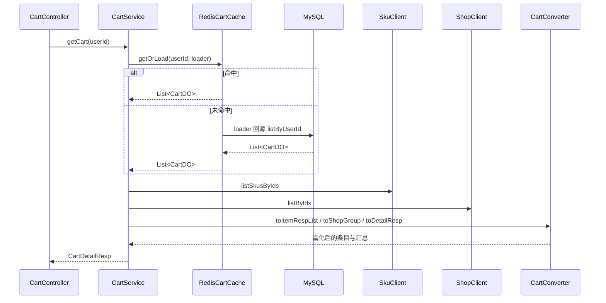
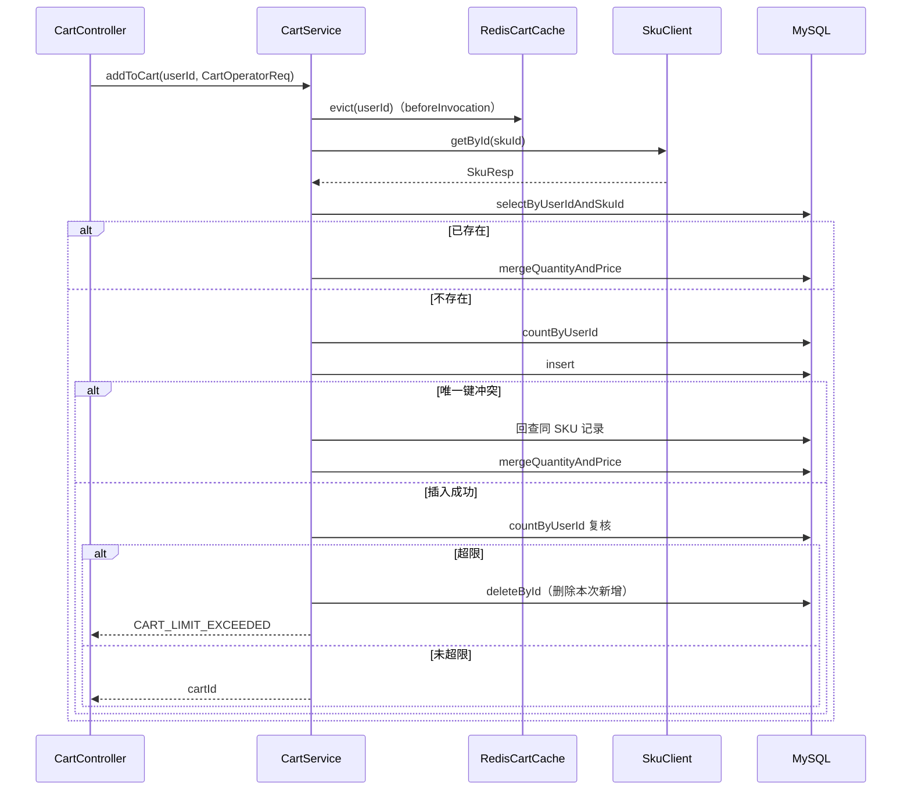

# 购物车组件设计

组件按"入口、服务、数据访问、转换、外部适配、缓存、边界约束"拆分；订单组件的划分见 `../../order-service/docs/order/02-component-design.md`。

## 组件清单

| # | 组件 | 位置 | 职责 |
|---|---|---|---|
| 1 | `CartController` | `services/cart-service/controller` | 购物车 HTTP 入口，只接收参数并调用服务 |
| 2 | `ICartService` | `services/cart-service/service` | 购物车能力契约，缓存对调用方透明 |
| 3 | `CartService` | `services/cart-service/service/impl` | 合并数量、容量复核、选中状态、缓存失效与响应组装 |
| 4 | `CartMapper` | `services/cart-service/mapper` | `cm_cart` 访问，默认方法 + Wrapper，禁止注解脚本 SQL |
| 5 | `CartConverter` | `services/cart-service/convert` | DO ↔ BO ↔ Req/Resp，MapStruct 转换 |
| 6 | `CartDO` | `services/cart-service/model/entity` | `cm_cart` 持久化对象，也是缓存值结构 |
| 7 | `CartItem` / `CartShopGroup` / `CartDetailResp` | `service-api/cart-api/model` | 购物车契约 DTO 与响应，不进缓存 |
| 8 | `ICartCache` | `services/cart-service/infrastructure/cache` | 购物车缓存契约 |
| 9 | `RedisCartCache` | `services/cart-service/infrastructure/cache/impl` | Spring Cache 注解实现 |
| 10 | `CartCacheConstants` | `services/cart-service/constant` | 缓存名常量 `cart:items` |
| 11 | `CartCacheProperties` | `services/cart-service/properties` | 缓存开关、键前缀、TTL 配置 |
| 12 | `CartCacheConfig` | `services/cart-service/config` | `@EnableCaching`、RedisCacheManager、CacheErrorHandler |
| 13 | `SkuClient` | `service-api/product-api` | 获取 SKU 实时快照与价格 |
| 14 | `ShopClient` | `service-api/user-api` | 获取店铺信息用于分组 |
| 15 | `BizErrorEnum` 购物车错误码 | `common` | 600xx 购物车错误码 |
| 16 | 数量与容量常量 | `services/cart-service/service/impl` | `MAX_ITEMS`、`MAX_QUANTITY`、`UNKNOWN_SHOP_ID` |

接口放在 `service/`，实现放在 `service/impl/`。技术能力放在 `infrastructure/cache/`，其中只放接口与 `impl/`，不放业务规则；配置类、配置属性和常量分别放 `config/`、`properties/`、`constant/`。

## 组件协作流程

### 查询购物车（Spring Cache）



### 添加购物车与缓存失效



`updateQuantity`、`removeItems`、`selectCartItem`、`selectAll`、`selectShop`、`clear` 同样在方法开头调用 `evict(userId)`。

## ICartService

```java
public interface ICartService {
    Long addToCart(Long userId, CartOperatorReq req);
    void updateQuantity(Long userId, CartOperatorReq req);
    void removeItems(Long userId, List<Long> skuId);
    void selectCartItem(Long userId, CartSelectReq req);
    void selectAll(Long userId, Boolean selected);
    void selectShop(Long userId, Long shopId, Boolean selected);
    CartDetailResp getCart(Long userId);
    void clear(Long userId);
    List<CartDO> listSelectedItems(Long userId);
}
```

缓存对 `ICartService` 调用方透明：

- `getCart` 通过 `ICartCache` 走缓存加速，但只缓存 `List<CartDO>`，不缓存 `CartDetailResp`。
- `listSelectedItems` 供下单链路使用，**绕过缓存直读数据库**，避免陈旧选中状态进入订单。

## CartMapper

数据访问全部用 `default` 方法 + `Wrappers.lambdaQuery/lambdaUpdate`，不使用 `@Select` 等注解脚本 SQL。与一致性和缓存相关的关键方法：

- `selectByUserIdAndSkuId`：按用户与 SKU 查已有记录，写路径必须走数据库。
- `countByUserId`：统计商品种数，用于容量校验与插入后复核，不能读缓存。
- `mergeQuantityAndPrice`：以期望数量为条件累加数量并刷新价格，返回影响行数用于发现并发变更。
- `listByUserId`：缓存未命中时的回源查询。
- `deleteById`、`deleteByUserId`、`deleteByUserIdAndSkuIds`：物理删除。

## CartConverter

所有 DO ↔ DTO 转换下沉到 MapStruct 的 `CartConverter`：

- `toDO(SkuResp sku, Long userId, Integer quantity)`：把实时 SKU 快照写入 `CartDO`。
- `toItemRespList`：用 SKU 实时信息富化购物车条目。
- `toShopGroup` / `toDetailResp`：构建店铺分组与全车汇总。

缓存中只存 `CartDO` 快照；价格、库存、可用性和小计由 converter 在每次读时基于实时 SKU 计算，不进缓存。

## ICartCache 与 RedisCartCache

```java
public interface ICartCache {
    List<CartDO> getOrLoad(Long userId, Supplier<List<CartDO>> loader);
    void evict(Long userId);
}
```

`RedisCartCache` 使用 Spring Cache 注解：

- `getOrLoad` 标注 `@Cacheable(cacheNames = "cart:items", key = "#userId")`；未命中时执行传入的 loader 回源数据库。
- `evict` 标注 `@CacheEvict(cacheNames = "cart:items", key = "#userId", beforeInvocation = true)`。
- 两个方法的 condition 均引用 `@cartCacheProperties.enabled`，配置关闭时注解不生效，直接执行方法体或空操作。

`RedisCartCache` 不访问 MySQL，不做判重、容量计算或修改选中状态。

## CartCacheConfig

- `@EnableCaching` 开启 Spring Cache。
- `cartCacheProperties()` 注册 `cloudmall.cart.cache.*` 配置，bean 名为 `cartCacheProperties`，供 SpEL 引用。
- `cartCacheManager(...)` 创建 `RedisCacheManager`：key 用 `StringRedisSerializer`，value 用 `GenericJackson2JsonRedisSerializer`，TTL 来自配置。
- `cartCacheErrorHandler()` 返回 `CacheErrorHandler`：缓存读写或失效异常只记日志，不向业务层传播，购物车自动降级为直读数据库。

## 缓存失效矩阵

| 操作 | 是否失效缓存 | 原因 |
| --- | --- | --- |
| `addToCart` | 是 | 新增或合并数量都会改变 `cm_cart` |
| `updateQuantity` | 是 | 数量变化 |
| `removeItems` | 是 | 删除记录 |
| `selectCartItem` / `selectAll` / `selectShop` | 是 | 选中状态变化 |
| `clear` | 是 | 清空购物车；订单收尾步骤走 `removeItems` 清理已下单项 |
| 插入后复核超限的补偿删除 | 是 | 数据库先增后删，最终仍要清理旧快照 |
| `getCart` | 否 | 缓存命中直接返回；未命中回填 |
| `listSelectedItems` | 否 | 直读数据库，不使用缓存 |
| 参数/金额/库存校验失败 | 是 | 写方法统一在入口失效，只是多一次删除，不产生脏数据 |

## 数据约束

```sql
cm_cart:
  UNIQUE KEY uk_user_sku (user_id, sku_id)
```

没有 `deleted` 列，删除即物理删除。`uk_user_sku` 是防重复的最终权威；数量上限由 `MAX_ITEMS` 与 `MAX_QUANTITY` 两个常量约束，并在插入后复核中通过删除本次新增来兜底，缺陷见 `./01-architecture.md`。缓存不做这些判断。

## Configuration & Constants

```yaml
cloudmall:
  cart:
    cache:
      enabled: true
      ttl: 5m
      key-prefix: ""

MAX_ITEMS = 100
MAX_QUANTITY = 99
UNKNOWN_SHOP_ID = -1L
```

`CartCacheProperties` 放 `properties/`，`CartCacheConfig` 放 `config/`，`CartCacheConstants.CART_ITEMS` 放 `constant/`。数量常量按现有方式保留在 `CartService`。购物车错误码使用 `BizErrorEnum` 的 60xxx 段。
