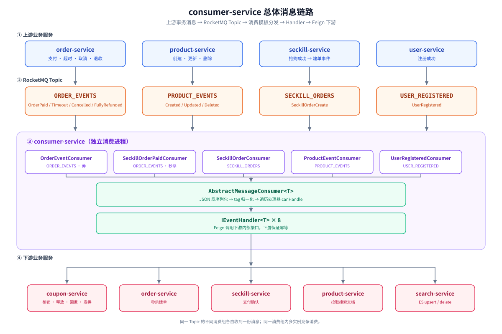
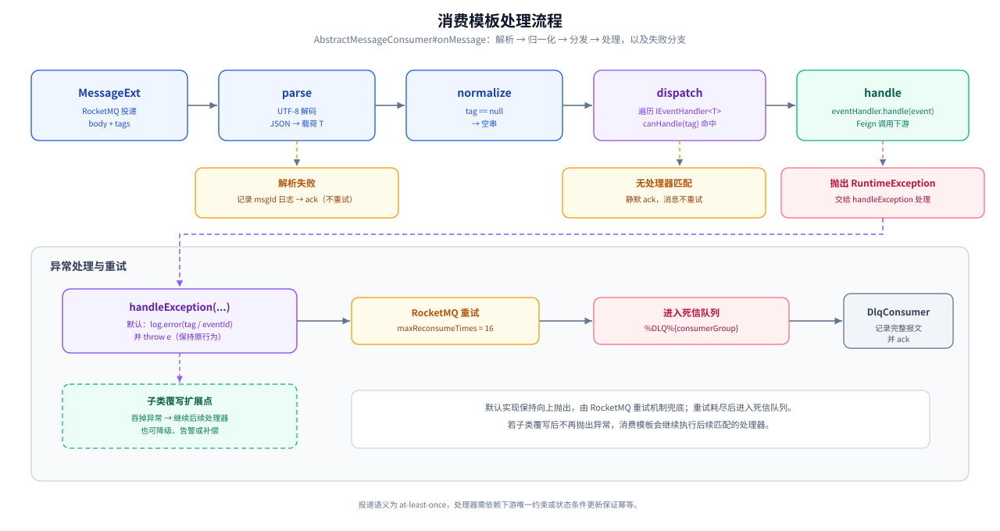
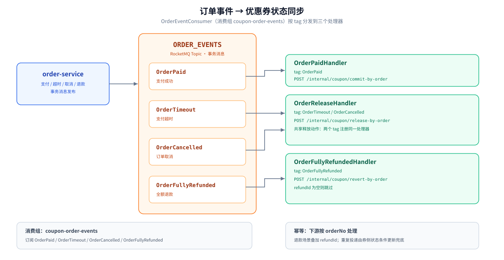
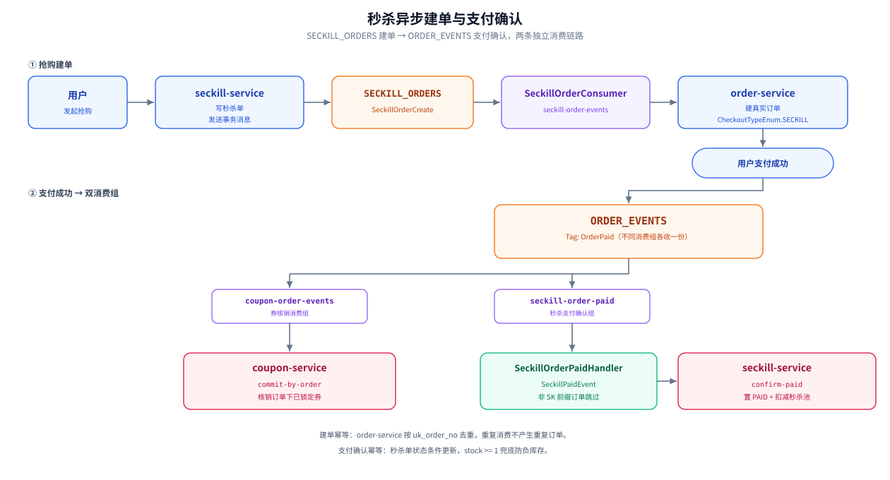
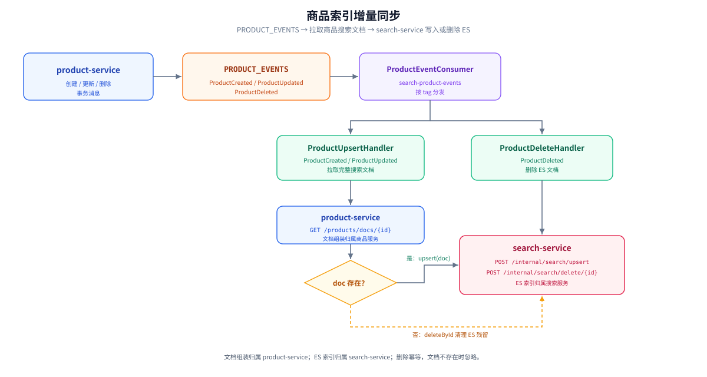
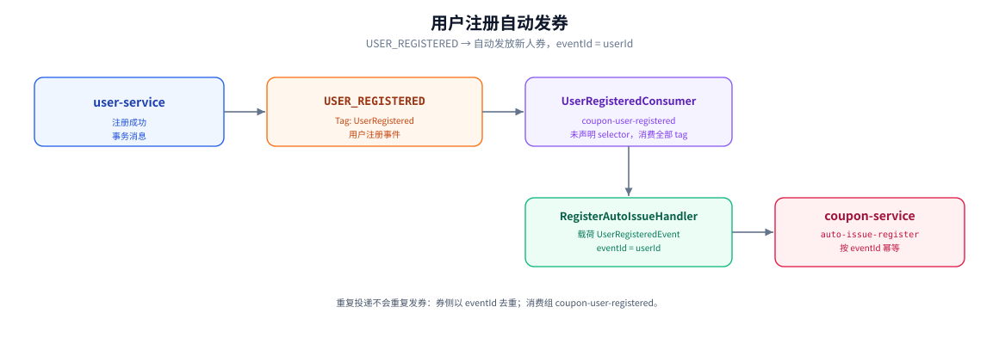

# consumer-service

独立部署的 RocketMQ 消息消费服务。

本服务只做消息接入与调用编排，不实现业务规则、不直接读写数据库；订单、优惠券、秒杀、商品、搜索等状态均由下游业务服务持有并保证幂等。

## 模块定位

- **入口**：RocketMQ 消息，无对外 HTTP 业务接口。
- **职责**：按 topic 订阅、按 tag 分发、调用下游内部接口。
- **不负责**：业务状态机、事务、幂等落库；这些由 coupon-service、order-service、seckill-service、product-service、search-service 各自承担。
- **部署形态**：独立 Spring Boot 进程，可水平扩容；同一消费组内多实例竞争消费。

## 技术栈与依赖

| 组件 | 用途 |
|------|------|
| Spring Boot 3.5.7 / Java 17 | 服务运行时 |
| Spring Cloud Alibaba Nacos | 服务注册发现 + 配置中心 |
| RocketMQ（`cloudmall-rocketmq-spring-boot-starter`） | 事件订阅；上游使用事务消息投递 |
| OpenFeign（`cloudmall-feign-spring-boot-starter`） | 调用下游内部接口，自动透传用户上下文并拆箱 `Result` |
| MyBatis-Plus / MySQL | 统一服务骨架依赖，当前模块无 Mapper / Entity，不访问数据库 |

## 目录结构

```
services/consumer-service/
├── pom.xml
├── assets/                                   # 流程图（SVG）
│   ├── overview.svg                          # 总体消息链路
│   ├── consumer-pipeline.svg                 # 消费模板处理流程
│   ├── order-coupon-flow.svg                 # 订单事件 → 优惠券同步
│   ├── seckill-flow.svg                      # 秒杀建单与支付确认
│   ├── product-index-flow.svg                # 商品索引增量同步
│   └── user-register-flow.svg                # 用户注册自动发券
└── src/main/
    ├── java/com/cloudmall/consumer/
    │   ├── ConsumerApplication.java          # 启动类，@EnableDiscoveryClient
    │   ├── consumers/
    │   │   ├── AbstractMessageConsumer.java  # 消费模板：解析、tag 归一、分发
    │   │   ├── OrderEventConsumer.java       # ORDER_EVENTS（券侧）
    │   │   ├── SeckillOrderPaidConsumer.java # ORDER_EVENTS（秒杀侧）
    │   │   ├── SeckillOrderConsumer.java     # SECKILL_ORDERS
    │   │   ├── ProductEventConsumer.java     # PRODUCT_EVENTS
    │   │   ├── UserRegisteredConsumer.java   # USER_REGISTERED
    │   │   └── DlqConsumer.java              # %DLQ%* 死信兜底
    │   └── handler/
    │       ├── IEventHandler.java            # tag 声明 + 幂等键 + 业务处理
    │       ├── OrderPaidHandler.java
    │       ├── OrderReleaseHandler.java
    │       ├── OrderFullyRefundedHandler.java
    │       ├── SeckillOrderCreateHandler.java
    │       ├── SeckillOrderPaidHandler.java
    │       ├── ProductUpsertHandler.java
    │       ├── ProductDeleteHandler.java
    │       └── RegisterAutoIssueHandler.java
    └── resources/application.yml
```

## 启动与配置

### 前置条件

本地依赖（MySQL / Redis / Nacos / RocketMQ / ES 等）已启动，且 Nacos 已导入 `docs/nacos/config` 下的配置：

```bash
docker compose -f docs/docker/compose.yaml up -d
./docs/docker/sh/sync-nacos-config.sh localhost docs/nacos/config
```

### 编译与运行

```bash
# 单模块编译（含依赖）
mvn clean compile -pl services/consumer-service -am

# 启动
mvn -pl services/consumer-service spring-boot:run
```

### 配置来源

| 配置 | 来源 | 说明 |
|------|------|------|
| `server.port` | 本地 `application.yml` | `9010` |
| `spring.application.name` | 本地 `application.yml` | `consumer-service`，Nacos 注册名 |
| `rocketmq.name-server` / `producer.group` | Nacos `common` | `localhost:9876` / `cloudmall-producer` |
| 数据源 / MyBatis-Plus | Nacos `common` | 模块当前不访问数据库 |
| 模块专属配置 | Nacos `consumer-service` | 当前仅声明 MyBatis 别名包 |
| 消费组 / topic / tag | 代码注解 | 见下方消费者清单，修改需同步发布 |

## 工作流程

### 总体链路

上游业务服务通过事务消息把事件投递到 RocketMQ，consumer-service 按消费组订阅并分发给处理器，再由处理器经 Feign 调用下游内部接口。



### 消费模板执行步骤

下图展示 `AbstractMessageConsumer#onMessage` 的完整处理路径，以及解析失败、无匹配处理器和业务异常三条分支：



1. `parse` 将消息体按 UTF-8 解码并反序列化为消费者声明的载荷类型 `T`。
2. `normalize` 归一化 tag：`null` 统一为空串，供无 tag 的 topic 使用。
3. 遍历 Spring 按泛型注入的 `List<IEventHandler<T>>`，对每个处理器调用 `canHandle(tag)`；命中的处理器依次执行 `handle(event)`。
4. 处理器内部通过 Feign 调用下游内部接口；下游以唯一约束、状态条件更新或事件 ID 保证幂等。
5. 处理器抛出 `RuntimeException` 时，模板调用可覆写的 `handleException`；默认记录 `tag` 与 `eventId` 后原样上抛，由 RocketMQ 重试。

子类可覆写 `handleException` 自定义异常处理；若覆写后不再抛出异常，消费模板会继续执行后续匹配的处理器。

> 分发不短路：同一 tag 命中多个处理器时，列表中的处理器会**全部执行**。因此同一消费组内应避免为同一 tag 注册多个语义重复的处理器；需要并行处理同一事件时，应像订单支付链路一样使用独立消费组 + 独立载荷类型。

### 消费者清单

| 消费者 | Topic | Tag 过滤 | 消费组 | 载荷 |
|--------|-------|----------|--------|------|
| `OrderEventConsumer` | `ORDER_EVENTS` | `OrderPaid` / `OrderTimeout` / `OrderCancelled` / `OrderFullyRefunded` | `coupon-order-events` | `OrderEvent` |
| `SeckillOrderPaidConsumer` | `ORDER_EVENTS` | `OrderPaid` | `seckill-order-paid` | `SeckillPaidEvent` |
| `SeckillOrderConsumer` | `SECKILL_ORDERS` | `SeckillOrderCreate` | `seckill-order-events` | `SeckillOrderCreateEvent` |
| `ProductEventConsumer` | `PRODUCT_EVENTS` | `ProductCreated` / `ProductUpdated` / `ProductDeleted` | `search-product-events` | `ProductEvent` |
| `UserRegisteredConsumer` | `USER_REGISTERED` | 未声明，默认 `*`（消费该 topic 全部消息） | `coupon-user-registered` | `UserRegisteredEvent` |
| `DlqConsumer` | `%DLQ%*` | — | `dlq-handler` | 原始 `MessageExt` |

业务消费者的 `maxReconsumeTimes` 均为 `16`；`DlqConsumer` 使用并发消费且不设置重试。

### 处理器与下游动作

| 处理器 | 命中 Tag | 下游动作 | 幂等依据 |
|--------|----------|----------|----------|
| `OrderPaidHandler` | `OrderPaid` | `POST /internal/coupon/commit-by-order`，核销订单下全部已锁定券 | `orderNo` |
| `OrderReleaseHandler` | `OrderTimeout` / `OrderCancelled` | `POST /internal/coupon/release-by-order`，释放订单下已锁定券 | `orderNo` + `userId` |
| `OrderFullyRefundedHandler` | `OrderFullyRefunded` | `POST /internal/coupon/revert-by-order`，回退已核销券；`refundId` 为空则跳过 | `orderNo` + `refundId` |
| `SeckillOrderCreateHandler` | `SeckillOrderCreate` | `POST /orders/SECKILL`，按秒杀侧预生成订单号建真实订单 | `orderNo`（`uk_order_no`） |
| `SeckillOrderPaidHandler` | `OrderPaid` | `POST /internal/seckill/confirm-paid`，秒杀单置 `PAID` 并扣减秒杀池；非 `SK` 前缀订单跳过 | `orderNo` + 状态条件更新 |
| `ProductUpsertHandler` | `ProductCreated` / `ProductUpdated` | `GET /products/docs/{id}` 拉取搜索文档，再 `POST /internal/search/upsert`；文档不存在时删除 ES 残留 | `productId` |
| `ProductDeleteHandler` | `ProductDeleted` | `POST /internal/search/delete/{id}` | `productId` |
| `RegisterAutoIssueHandler` | `UserRegistered` | `POST /internal/coupon/auto-issue-register`，发放新人券 | `eventId = userId` |

## 关键业务链路

### 订单生命周期 → 优惠券状态同步

`order-service` 在支付、超时、取消、全额退款时发送 `ORDER_EVENTS` 事务消息，`OrderEventConsumer` 按 tag 分发给对应处理器：



| 订单事件 | 优惠券动作 | 典型前置状态 |
|----------|------------|--------------|
| `OrderPaid` | 核销订单下全部已锁定券 | 下单时已锁定 |
| `OrderTimeout` / `OrderCancelled` | 释放订单下全部已锁定券 | 支付前释放 |
| `OrderFullyRefunded` | 回退订单下全部已核销券 | 支付后退款 |

`OrderFullyRefundedHandler` 在 `refundId` 为空时直接返回，避免无退款单的无效调用。

### 秒杀异步建单与支付确认

秒杀链路跨越两个 topic，由两个独立阶段组成：



- 建单订单号由秒杀侧预生成，`order-service` 以 `uk_order_no` 幂等，重复消费不会产生重复订单。
- 支付确认只处理 `SK` 前缀订单号，普通订单直接跳过，避免无谓跨服务调用。
- 秒杀支付确认使用独立载荷 `SeckillPaidEvent` 与独立消费组 `seckill-order-paid`：既保证与券核销各自收到一份 `OrderPaid`，又通过泛型隔离避免两套处理器互相注入。

### 商品索引增量同步

`product-service` 的商品写操作提交后发送 `PRODUCT_EVENTS` 事务消息。搜索文档的组装归属 `product-service`，ES 索引归属 `search-service`：



- 创建 / 更新：消费后按 `productId` 拉取完整搜索文档，再委托 `search-service` 写入 ES。
- 删除：消费后委托 `search-service` 删除文档；删除幂等，文档不存在时忽略。
- 乱序兜底：若「先删后消费」导致文档已不存在，`ProductUpsertHandler` 会主动清理 ES 残留文档，保证最终一致。

### 用户注册自动发券

`user-service` 注册成功后发送 `USER_REGISTERED`。`RegisterAutoIssueHandler` 以 `userId` 作为 `eventId` 调用 `coupon-service` 的自动发券接口；券侧按 `eventId` 幂等，重复投递不会重复发券。



## 幂等、重试与死信

| 场景 | 行为 | 结果 |
|------|------|------|
| 正常处理 | 处理器调用下游成功 | 消费成功，提交位点 |
| JSON 解析失败 | 记录 `消息解析失败 msgId=...` 后返回 | **ack**，消息不重试，需依赖日志告警排查 |
| tag 无处理器匹配 | 遍历结束，无异常 | **ack**，消息被静默忽略 |
| 处理器抛 `RuntimeException` | 默认记录 `事件处理失败 tag=... eventId=...` 后上抛（`handleException`） | RocketMQ 重试，最多 16 次 |
| 重试耗尽 | Broker 转入 `%DLQ%{consumerGroup}` | `DlqConsumer` 记录完整报文并 ack，不再重投 |

幂等约定：

- 投递语义为 **at-least-once**，重复消费不可避免。
- 消费模板的 `eventId` 当前**仅用于失败日志定位**，不做去重；幂等由下游业务保证（唯一键、状态条件更新、事件 ID 去重表等）。
- 消费者默认并发消费，不保证同一订单/商品的事件顺序；下游需以状态条件更新或幂等键兜底。

## 扩展新消费者

新增一条事件链路需要同时改动消费者与处理器，并确认下游幂等：

1. 在对应 `service-api` 模块定义事件载荷，或复用已有类型。
2. 新建消费者，继承 `AbstractMessageConsumer<T>`：

```java
@Component
@RocketMQMessageListener(
        topic = "XXX_EVENTS",
        consumerGroup = "xxx-consumer",
        selectorType = SelectorType.TAG,
        selectorExpression = "XxxCreated",
        maxReconsumeTimes = 16
)
public class XxxEventConsumer extends AbstractMessageConsumer<XxxEvent> {

    public XxxEventConsumer(List<IEventHandler<XxxEvent>> handlers) {
        super(handlers, XxxEvent.class);
    }
}
```

3. 新建处理器，声明服务的 tag 集合，并在 `handle` 中调用下游：

```java
@Component
@RequiredArgsConstructor
public class XxxCreatedHandler implements IEventHandler<XxxEvent> {

    private final InternalXxxClient internalXxxClient;

    @Override
    public Set<String> tagSet() {
        return Set.of("XxxCreated");
    }

    @Override
    public boolean canHandle(String tag) {
        return tagSet().contains(tag);
    }

    @Override
    public String eventId(XxxEvent event) {
        return event.getBizId();
    }

    @Override
    public void handle(XxxEvent event) {
        internalXxxClient.doSomething(event.getBizId());
    }
}
```

4. 在 `pom.xml` 中补充对应 `service-api` 依赖（当前通过聚合 POM 已引入全部 API，可直接使用）。
5. 确认下游接口幂等，再联调重复投递与失败重试。

注意事项：

- 新增 tag 必须同步更新 `selectorExpression`；否则消息在 Broker 侧即被过滤，处理器不会被调用。
- 不同消费组可以重复订阅同一 tag 做不同业务（各自收到一份消息）；同一消费组内不要为同一 tag 注册语义重复的处理器。
- 修改消费组名会形成新的消费位点，历史消息不会自动补消费。
- 需要自定义异常处理时覆写 `handleException`；默认记录 `tag` / `eventId` 并上抛，覆写后不抛出则继续后续处理器。

## 相关文档

- [项目主 README](../../README.md)
- [RocketMQ Starter](../../starters/cloudmall-rocketmq-spring-boot-starter/README.md)
- [Outbox Starter](../../starters/cloudmall-outbox-spring-boot-starter/README.md)
- [优惠券设计](../../docs/design/coupon/coupon-design.md)
- [秒杀设计](../../docs/design/seckill/seckill-design.md)
- [商品设计](../../docs/design/product/product-design.md)
