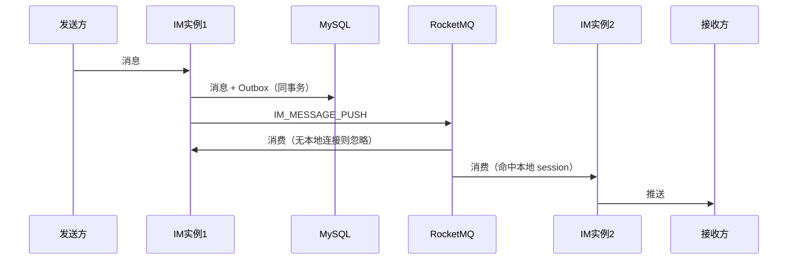

# IM 分布式部署设计

## 架构

- **连接**：WebSocket 仍由 IM 实例持有，`localSessions` 保持本地。
- **路由**：Redis `im:route:{userId}` 记录 `{instanceId, sessionId, lastHeartbeat}`；心跳续期，关闭时按 instanceId + sessionId 条件删除。
- **消息**：发送链路只做“消息落库 + Outbox 事件 `IM_MESSAGE_PUSH`”；不再在发送方实例直接推送。
- **消费**：第一阶段 RocketMQ 广播消费，所有实例都收到事件，只有持有接收方本地连接的实例推送；后续按 `instanceId` 路由优化。
- **可靠性**：MySQL 消息为准，MQ 推送是加速通道；`messageId` 幂等，按 `sessionId` 保序，重连后用 cursor 历史补齐。

