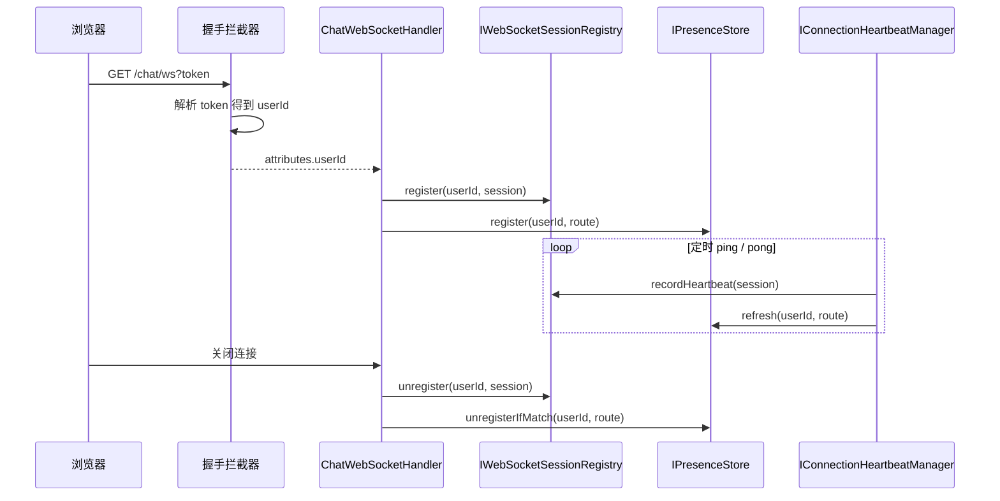
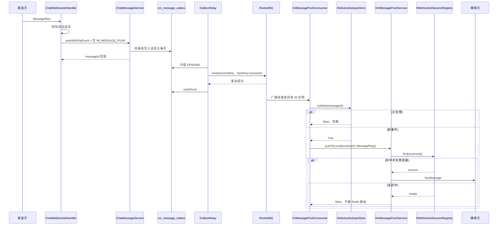

# IM 组件设计

组件按“连接、在线状态、事件、推送”拆分，`ChatWebSocketHandler` 不再直接依赖 Redis/MQ。

## 组件清单

| # | 组件 | 位置 | 职责 |
|---|---|---|---|
| 1 | `IInstanceIdProvider` | `services/im-service/infrastructure` | 提供本进程唯一实例 ID |
| 2 | `IWebSocketSessionRegistry` | `services/im-service/infrastructure` | 管理本地 `WebSocketSession` |
| 3 | `IPresenceStore` | `services/im-service/infrastructure` | 维护 Redis 在线路由 |
| 4 | `IConnectionHeartbeatManager` | `services/im-service/infrastructure` | 心跳、续期、清理半开连接 |
| 5 | `ImMessagePushEvent` | `service-api/im-api/model/event` | 跨实例消息契约 |
| 6 | `IImMessageEventPublisher` | `services/im-service/infrastructure` | 封装 MQ 发送 |
| 7 | `IOutboxRelay` | 桥接模块 | Outbox 记录搬运到 MQ |
| 8 | `ImMessagePushConsumer` | `services/im-service/infrastructure` | 消费并触发本地推送 |
| 9 | `IImMessagePushService` | `services/im-service/infrastructure` | 写到本地连接 |
| 10 | `IPushDispatcher` | `services/im-service/infrastructure` | 广播/按实例路由策略 |
| 11 | `IDeliveryDedupeStore` | `services/im-service/infrastructure` | 消费端幂等 |
| 12 | 配置与常量 | `services/im-service/infrastructure` | 配置项与常量键值 |

定时任务放在 `services/im-service/job` 与桥接模块的 `.../job`；接口实现类放在 `services/im-service/infrastructure/impl`。

## 组件协作流程

### 连接建立与心跳



### 消息发送与推送（广播阶段）



按实例路由阶段，Relay 先用 `IPresenceStore.routes(receiverId)` 找目标实例，再只投递目标实例；消费端逻辑不变。

## IInstanceIdProvider

- 读取 `cloudmall.im.instance-id`，未配置则生成 UUID。
- 进程内稳定，重启换新；旧路由靠 TTL 过期。

```java
public interface IInstanceIdProvider {
    String get();
}
```

## IWebSocketSessionRegistry

职责：注册/注销会话、按 `userId` 查本地会话、记录心跳、发现超时会话、向本地会话发送文本帧。若支持多端，值改为会话集合。

边界：不访问 Redis、不发 MQ、不判断全局在线。

```java
public interface IWebSocketSessionRegistry {
    void register(Long userId, WebSocketSession session);
    void unregister(Long userId, WebSocketSession session);
    Collection<WebSocketSession> find(Long userId);
    List<Long> findStale(Duration maxIdle);
    void recordHeartbeat(WebSocketSession session);
    boolean sendToLocal(Long userId, String payload);
}
```

## IPresenceStore

```text
im:route:{userId}  Hash
  field: sessionId
  value: {instanceId, lastHeartbeat}
  TTL: presence-ttl
```

职责：注册/续期路由、查询用户所在实例、按 `instanceId + sessionId` 条件删除。

边界：不持有 `WebSocketSession`，不推送；本地查不到会话时不能直接删除在线标记。

```java
public interface IPresenceStore {
    void register(Long userId, UserRoute route);
    void refresh(Long userId, UserRoute route);
    List<UserRoute> routes(Long userId);
    void unregisterIfMatch(Long userId, UserRoute route);
}
```

## IConnectionHeartbeatManager

从 `ChatWebSocketHandler` 抽出：定时 ping、pong 更新本地心跳、刷新 Redis TTL、关闭超时连接并注销路由。

不处理消息业务，不负责全局在线查询。

```java
public interface IConnectionHeartbeatManager {
    void record(WebSocketSession session);
    void refreshPresence(Long userId, String sessionId);
    void cleanupStale();
}
```

## ImMessagePushEvent

跨实例契约：`service-api/im-api/model/event/ImMessagePushEvent.java`。

字段：`messageId`、`sessionId`、`senderId`、`receiverId`、`type`、`content`、`createdAt`。

不引用 DO/BO/Resp；事件发布后不可变。事件类型常量放 `ImEventConstants.IM_MESSAGE_PUSH`。

## IImMessageEventPublisher

职责：发送 `ImMessagePushEvent` 到 `im-message-push`；`messageId` 作 KEYS，`sessionId` 作 orderly hashKey；发送失败不吞异常。

边界：不写数据库，不关心连接归属；事务一致性由 Outbox 保证。

```java
public interface IImMessageEventPublisher {
    void publish(ImMessagePushEvent event);
}
```

## IOutboxRelay

职责：按 `app_name` 和 eventType 扫描待投递事件、解析 payload 与目标 topic/tag、调用 MQ 发送，交给 `OutboxRepository` 标记完成或失败退避。

边界：不写业务数据、不产生业务事件、不做 WebSocket 推送。第一阶段只接管 `IM_MESSAGE_PUSH`，`FILE_BIND` 暂由 `fileEventApply` 直接消费。

现有 `OutboxMapper.listPending` 没有按 appName 过滤，需补充。发送与 markDone 非原子，消费端必须按 `messageId` 幂等。

建议位置：`starters/cloudmall-outbox-rocketmq-spring-boot-starter`。

## ImMessagePushConsumer

职责：反序列化事件、按 `messageId` 去重、用 `ChatMessageConverter` 转 `MessageResp`、调用 `IImMessagePushService`。

查不到本地会话时直接忽略，不删除 Redis 在线标记；不访问数据库业务表，不判断会话成员关系。

广播消费阶段所有实例都收到事件；按实例路由优化后只投递目标实例。

## IImMessagePushService

职责：按 `receiverId` 从注册表查本地会话、序列化并发送文本帧、发送失败时注销本地会话、返回是否命中。

不访问 Redis，不发 MQ，不做幂等判断。

```java
public interface IImMessagePushService {
    boolean pushToLocal(Long receiverId, MessageResp message);
}
```

## IPushDispatcher

用于隔离“广播还是按实例路由”，避免业务代码感知 MQ 细节。

- `BroadcastPushDispatcher`：发布到公共 topic，所有实例消费，本地命中才推送。
- `RoutedPushDispatcher`：根据 `IPresenceStore` 找目标实例，再按实例投递。

第一阶段只用广播实现，后续替换实现即可。

```java
public interface IPushDispatcher {
    void dispatch(ImMessagePushEvent event);
}
```

## IDeliveryDedupeStore

职责：用 Redis `SET NX` 标记 `im:push:done:{messageId}`，TTL 略长于 MQ 重试窗口；重复事件忽略。

只做推送层幂等，消息唯一性仍由数据库主键保证。

```java
public interface IDeliveryDedupeStore {
    boolean tryMark(String messageId);
}
```

## Configuration & Constants

```yaml
cloudmall:
  im:
    presence-ttl-seconds: 600
    heartbeat:
      stale-timeout-seconds: 90
    mq:
      topic: im-message-push
      tag: push
      consumer-group: im-service
    push-mode: broadcast
  outbox-relay:
    enabled: true
    app-name: im-service
    event-types:
      - IM_MESSAGE_PUSH

xxl:
  job:
    executor:
      app-name: im-service
      port: 9994
    auto-register:
      enabled: true
      jobs:
        - handler: outboxRelay
          schedule-type: FIX_RATE
          schedule-conf: "1"
        - handler: imHeartbeatPing
          schedule-type: FIX_RATE
          schedule-conf: "30"
        - handler: imStaleSessionCleanup
          schedule-type: FIX_RATE
          schedule-conf: "60"
```

定时任务统一由 XXL-JOB 注册：`outboxRelay`、`imHeartbeatPing`、`imStaleSessionCleanup`，不再使用 `@Scheduled`。Outbox 参数沿用 `cloudmall.outbox.*`；常量放接口：`ImEventConstants.IM_MESSAGE_PUSH`、`ImRedisConstants.ROUTE_PREFIX`。
