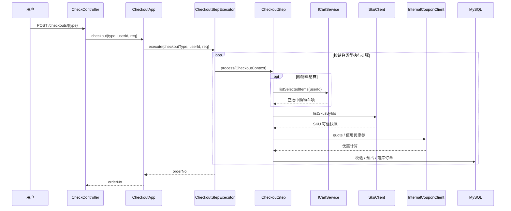

# 订单域架构设计

## 架构总览

- **入口**：`CheckController` 接收结算请求，`OrderController` 接收订单查询请求，`PaymentController` 接收支付回调；`CheckoutApp`、`PaymentApp` 作为应用编排层，Controller 不写业务规则。
- **结算**：`POST /checkouts/{type}` 调用 `CheckoutApp.checkout`，按结算类型委托 `CheckoutStepExecutor`；执行器按 `CheckoutTypeEnum` 选择步骤列表，逐步填充 `CheckoutContext`，最后一步落库订单。`GET /checkouts/preview` 调用 `CheckoutApp.preview` 做无副作用价格预览。
- **步骤编排**：购物车结算为 `LOAD_DELIVERY_ADDRESS → LOAD_SELECTED_CART_ITEMS → LOAD_TRUSTED_SKU_SNAPSHOTS → EXECUTE_CHECKOUT_SAGA → REMOVE_ORDERED_CART_ITEMS`；正常结算与秒杀先 `CHECK_SINGLE_ITEM`，再加载地址、请求商品、SKU，最后分别走普通预占与秒杀下单。
- **下单 Saga**：`EXECUTE_CHECKOUT_SAGA` 是 Saga 容器步骤，自身定义主干流程：按 `CREATE_ORDER_SKELETON → RESERVE_ORDER_STOCK → LOCK_USER_COUPONS → WRITE_ORDER_DETAILS` 顺序执行子步骤；异常时仅在该组合内逆序补偿（取消订单、释放库存、释放券），不波及管道后续步骤。补偿失败由超时恢复任务兜底。
- **购物车边界**：购物车作为下单输入域，由 `ICartService` 提供已选中条目；购物车自身的写入、容量与一致性设计见 `../cart/01-architecture.md`。
- **数据凭据**：订单、子订单、优惠关联在 `cm_mall` 的 MySQL 表；SKU 快照与价格来自 `product-service` 的 `SkuClient`，优惠券计算来自 `coupon-service` 的 `InternalCouponClient`。
- **库存**：下单步骤只做预占与校验，真实库存扣减由商品服务承接；订单不直接修改商品库存表。
- **事件一致性**：下单步骤本身只做订单落库，不通过 Outbox 或事务消息发布订单事件。订单生命周期状态变更通过 RocketMQ 事务消息发布：`OrderEventService` 发送消息，`OrderTxMessageListener` 在同一事务内执行本地状态变更并支持回查；消费端按 `orderNo` 和 tag 幂等处理。通用 Outbox 表不参与订单事件。
- **支付**：`PaymentApp` 编排支付单创建、状态查询与回调；回调经 `WechatPayCallbackVerifier` 验签后调用 `IOrderEventService`，再经事务消息与状态机迁移订单状态。
- **状态机**：`IOrderStateMachineService` 用 `from` 状态作为条件更新，影响行数为零时视为冲突或已变更，避免并发覆盖。
- **定时任务**：XXL-JOB 执行 `OrderTimeoutRecoveryJobHandler`，补偿未支付超时订单；不使用 `@Scheduled`。

## 订单生命周期事件

订单生命周期事件不跟随下单落库一起发布，而是在支付成功、超时、取消、全额退款发生时由 `IOrderEventService` 产生事务消息：

- `OrderEventService` 构造 `OrderEvent`，调用 `MQProducer.sendInTransaction`，以 `orderNo` 作 `EVENT_ID`、以 `OrderTagEnum` 作 tag。
- `OrderTxMessageListener.executeLocalTransaction` 在同一事务内调用 `OrderMapper` 或 `IOrderStateMachineService` 完成父订单状态变更；`checkLocalTransaction` 按订单当前状态回查提交或回滚。
- 下游 `OrderEventConsumer` 按 tag 分发到对应 handler，按 `orderNo` 做幂等。

具体组件协作见 `./02-component-design.md`。

## 订单与购物车的边界

订单域只读取购物车已选中条目作为下单输入，不接管购物车的容量、去重与缓存策略。购物车清空由 `REMOVE_ORDERED_CART_ITEMS` 步骤在订单落库后调用购物车域完成；两步不在同一本地事务里，因此购物车清理失败不应回滚已落库订单，后续靠幂等或补偿保证一致。
