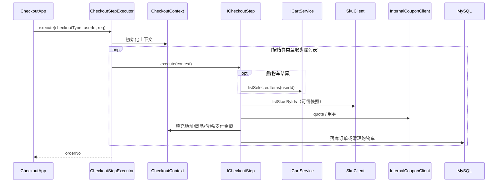
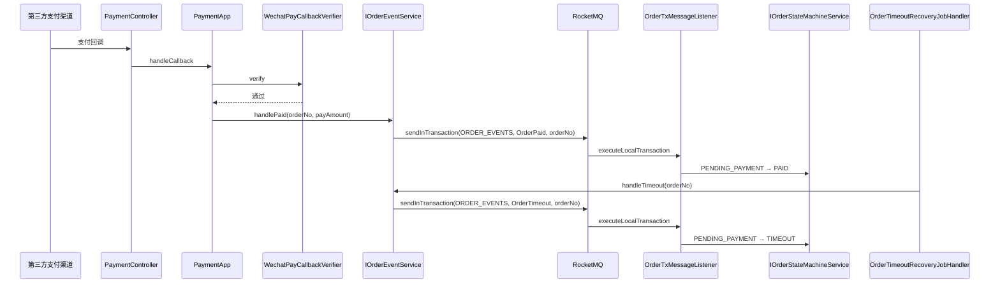
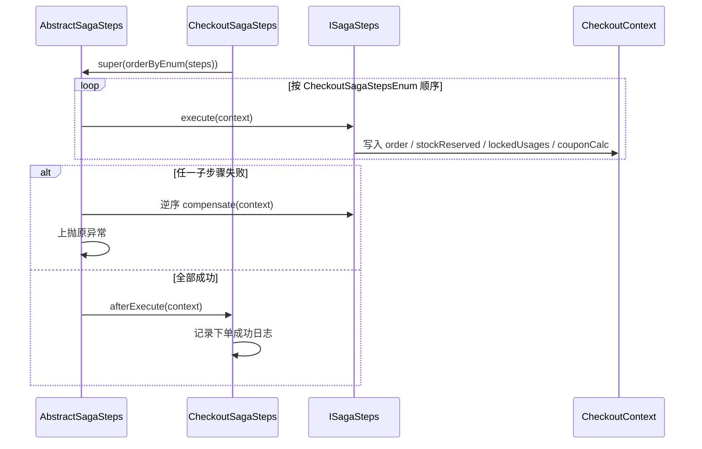

# 订单组件设计

组件按"入口、编排、步骤、领域服务、外部适配、事件与任务"拆分。`CheckController` 承接结算入口，`OrderController`/`PaymentController` 分别承接查询与支付回调；`CheckoutApp`/`PaymentApp` 只做编排，业务规则落在步骤和领域服务中；购物车已独立为 `cart-service`，组件见 `../../cart-service/docs/cart/02-component-design.md`。

## 组件清单

| # | 组件 | 位置 | 职责 |
|---|---|---|---|
| 1 | `CheckController` | `services/order-service/controller` | 结算入口：`POST /checkouts/{type}` 下单、`GET /checkouts/preview` 预览 |
| 2 | `CheckoutApp` | `services/order-service/application/checkout` | 统一建单入口与下单前价格预览 |
| 3 | `PaymentApp` | `services/order-service/application` | 创建支付单、查询支付状态、接收回调并驱动订单状态 |
| 4 | `CheckoutStepExecutor` | `services/order-service/application/checkout` | 按结算类型映射步骤列表并顺序执行 |
| 5 | `ICheckoutStep` | `services/order-service/application/checkout/step` | 结算步骤契约 |
| 6 | `CheckoutStepEnum` | `services/order-service/application/checkout/step` | 步骤枚举与日志、排序标识 |
| 7 | `AbstractSagaSteps` | `services/order-service/application/checkout/step/saga` | Saga 容器抽象基类：提供顺序执行与逆序补偿主干流程 |
| 8 | `CheckoutSagaSteps` | `services/order-service/application/checkout/step/saga` | 结算 Saga 容器步骤：只声明子步骤与顺序，限定补偿边界 |
| 9 | `REMOVE_ORDERED_CART_ITEMS` / `RemoveOrderedCartItemsStep` | `services/order-service/application/checkout/step` | 管道收尾步骤：订单落库后尽力清车，失败不回滚订单 |
| 10 | `ISagaSteps` / `CheckoutSagaStepsEnum` | `services/order-service/application/checkout/step/saga` | Saga 子步骤契约与唯一子步骤枚举 |
| 11 | `InternalCartClient` | `service-api/cart-api/client` | 购物车内部 Feign 客户端，读已选中项与清购物车 |
| 12 | `IOrderService` | `services/order-service/service` | 父/子订单本地查询与优惠统计 |
| 13 | `IOrderEventService` | `services/order-service/service` | 支付、超时、取消、退款等生命周期事件 |
| 14 | `IOrderStateMachineService` | `services/order-service/service` | 父/子订单状态迁移与合法性校验 |
| 15 | `IPaymentService` | `services/order-service/service` | 支付单本地数据与可支付订单快照 |
| 16 | `WechatPayCallbackVerifier` | `services/order-service/payment` | 微信支付风格回调验签 |
| 17 | `OrderTxMessageListener` | `services/order-service/listener` | 处理事务消息本地事务：执行订单状态变更并回查 |
| 18 | `OrderTimeoutRecoveryJobHandler` | `services/order-service/job` | XXL-JOB 超时订单补偿与 Saga 补偿失败兜底 |
| 19 | `OrderConverter` / `PaymentConverter` | `services/order-service/convert` | 订单与支付对象转换 |
| 20 | `OrderMapper` 等 | `services/order-service/mapper` | MyBatis-Plus 数据访问，默认方法 + Wrapper |
| 21 | 配置与常量 | `services/order-service/config`、`properties` | 支付参数、MQ topic/tag、XXL-JOB 注册项 |

接口放在 `service/`、结算步骤契约放在 `application/checkout/step/`，实现类放在 `service/impl/`；Saga 相关类统一放在 `application/checkout/step/saga/`；新增 Saga 容器时继承 `AbstractSagaSteps`，并定义独立的标记接口与子步骤枚举以隔离 Bean 注入范围；入口适配器放在 `controller/`；MQ 监听与定时任务分别放在 `listener/`、`job/`。

## 组件协作流程

### 结算下单



下单链路只落库，不发布生命周期事件；事件由后续支付、超时、取消、退款等触发。

### 支付回调与超时补偿



## ICheckoutStep

```java
public interface ICheckoutStep {
    CheckoutStepEnum name();
    void execute(CheckoutContext context);
}
```

步骤只负责一个关注点，通过 `CheckoutContext` 传递数据。`CheckoutStepExecutor` 负责编排，`CheckoutApp` 负责对外入口，Controller 不感知步骤细节。

## 下单 Saga

`CheckoutSagaSteps` 是结算管道中的结算 Saga 容器步骤，对外仍为 `EXECUTE_CHECKOUT_SAGA`。主干流程由 `AbstractSagaSteps` 统一提供，容器自身只声明子步骤与顺序：

类名末尾的 `s` 表示该组件承载的是一组步骤而非单一步骤。



补偿边界仅在该 Saga 内：创建步骤补偿为标记取消、预占步骤为释放库存、锁券步骤为逐张释放券、落库步骤无补偿（本地事务失败即回滚）。补偿幂等且尽力而为，失败由 `OrderTimeoutRecoveryJobHandler` 兜底；清车已移出 Saga，作为管道收尾步骤 `REMOVE_ORDERED_CART_ITEMS` 尽力执行，失败只记日志不影响订单。新增 Saga 容器时继承 `AbstractSagaSteps`，显式列举需要的子步骤，即可复用主干流程。

## IOrderService

```java
public interface IOrderService {
    OrderResp getById(Long id);
    PageResp<OrderResp> page(OrderPageReq req);
    PageResp<OrderSubResp> pageMerchant(OrderSubPageReq req);
    CouponUsageStatsResp usageByCoupon(Long couponId);
    CouponUsageStatsResp usageOverview();
}
```

只承载本地查询与响应组装；下单、预览等涉及远程调用的流程由 `CheckoutApp` 编排。

## IOrderEventService

```java
public interface IOrderEventService {
    void handlePaid(String orderNo, BigDecimal payAmount);
    void handleTimeout(String orderNo);
    void handleCancel(String orderNo);
    void handleFullyRefunded(String orderNo, String refundId, BigDecimal refundAmount);
}
```

事件类型复用 `OrderTagEnum` 作为 RocketMQ Tag；金额校验在事件侧完成，状态变更由状态机执行；非法迁移直接抛业务异常。

## IOrderStateMachineService

```java
public interface IOrderStateMachineService {
    void transitionParent(Long orderId, ParentOrderStatusEnum from, ParentOrderStatusEnum to);
    void transitionSub(Long subOrderId, SubOrderStatusEnum from, SubOrderStatusEnum to);
    boolean canParentTransition(ParentOrderStatusEnum from, ParentOrderStatusEnum to);
    boolean canSubTransition(SubOrderStatusEnum from, SubOrderStatusEnum to);
}
```

状态迁移以 `from` 为条件更新，影响行数为零时视为并发冲突或已变更，避免并发覆盖。

## OrderTxMessageListener

负责处理 RocketMQ 事务消息的本地事务：`executeLocalTransaction` 从 header 读取 `orderNo` 与 `eventType`，调用 `OrderMapper` 或 `IOrderStateMachineService` 完成订单状态变更并返回提交或回滚；`checkLocalTransaction` 根据订单当前状态决定提交、回滚或继续回查。事务消息由 `OrderEventService` 经 `MQProducer` 发送，消费端按 `orderNo` 与 tag 幂等处理。

## OrderTimeoutRecoveryJobHandler

统一由 XXL-JOB 注册执行，扫描超时未支付父订单并调用 `IOrderEventService.handleTimeout`。不在服务内使用 `@Scheduled`。

## Configuration & Constants

```yaml
cloudmall:
  order:
    timeout:
      scan-minutes: 30
  payment:
    notify-url: http://gateway/inner/payment/notify
  mq:
    order-topic: ORDER_EVENTS
xxl:
  job:
    executor:
      app-name: order-service
    auto-register:
      enabled: true
      jobs:
        - handler: orderTimeoutRecovery
          schedule-type: FIX_RATE
          schedule-conf: "60"
```

配置项放 `properties/`，常量接口放 `constant/`，`@Configuration` / `@Bean` 放 `config/`。MQ topic/tag、支付回调路径和定时任务标识不要在代码其他位置散落字符串。
